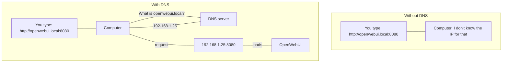
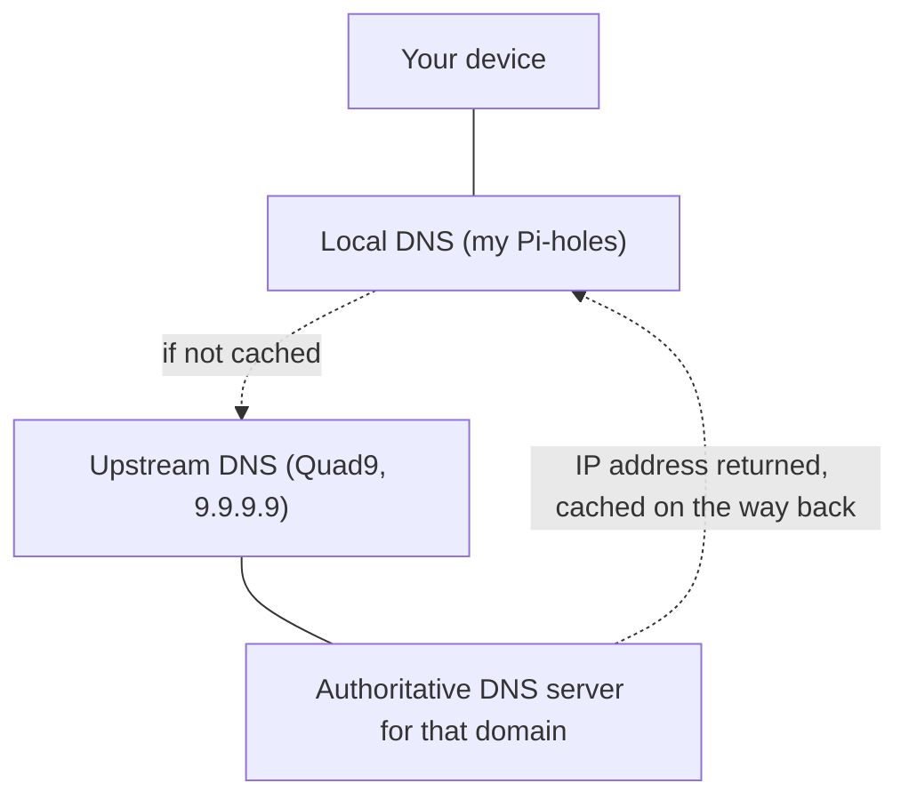
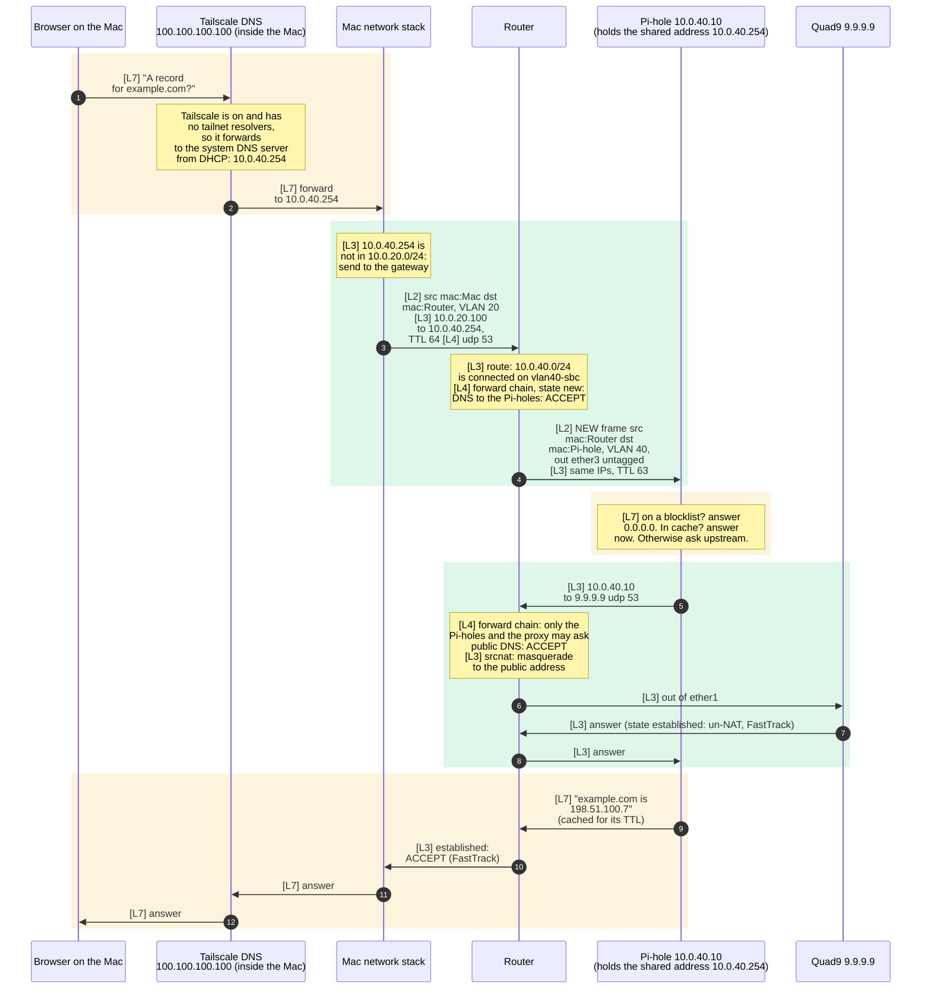

# DNS Fundamentals

DNS converts human-readable names into IP addresses. Without it, every service would need to be reached by raw address.

Think of the contacts app on your phone. You tap a name and it dials the number.



## DNS Resolution Chain

Your device asks one DNS server. That server asks others when it does not know the answer, and remembers answers for a while.



## How My Lab Answers

Every VLAN gets the same two DNS servers from DHCP: the shared address `10.0.40.254` first, then `10.0.40.11`.

Behind them are two Pi-holes on Raspberry Pis, `10.0.40.10` and `10.0.40.11`. The first one normally holds the shared address, and the second can take it over if the first dies. The Pi-holes block ad and tracker names, answer the lab's own names themselves, and ask Quad9 for everything else.

[Pi-hole In A Homelab](/pages/networking/pihole) covers running them.

## One Name, Hop By Hop

Here is my Mac looking up a website, with Tailscale switched on:



The address in the answer is from a range set aside for documentation;[^5] the real one does not matter here.

What to notice:

- **Every internal VLAN may ask the Pi-holes**, even the isolated ones that have no internet. DNS to the Pi-holes is the one thing they all share.
- **DNS is UDP, but big answers switch to TCP**, so every DNS rule in my firewall exists twice, once for each.[^1]
- **Only the Pi-holes and the proxy may ask public DNS directly.** A device in an isolated VLAN that ignores DHCP and asks `8.8.8.8` itself is dropped. An IoT device that tries is answered by the Pi-hole instead, because the router redirects its lookup. My trusted VLANs (management, compute and the main Wi-Fi) have general internet, so a device there can use public DNS and skip the blocking. I trust them with that.
- **My Mac adds one hop inside itself** while Tailscale's "Use Tailscale DNS" is on. Apps ask Tailscale's local resolver at `100.100.100.100`,[^2] which forwards names outside the tailnet to the DHCP-provided server. I checked this on my Mac on 25 October 2026: `scutil --dns` listed `100.100.100.100` as resolver 1, and `tailscale dns status` showed no tailnet resolvers ("system default will be used"). With that option off, apps ask `10.0.40.254` directly.

To check it yourself, `dig @10.0.40.10 example.com +short` asks one Pi-hole directly, and `dig example.com` goes the normal way.

## One Dead Server Makes Everything Flaky

Before I rebuilt the network, DHCP handed out one DNS server that no longer existed, alongside the working one.

Nothing failed outright. Some lookups were instant, others hung for seconds. A resolver that never answers forces the client to wait for a timeout before it tries the next one, so the network felt flaky rather than broken.

If some pages load instantly and others hang, check the DNS servers a device was given before anything else. And if "everything is down" but `ping 1.1.1.1` works, it is most likely DNS.

## Lab Names

The Pi-holes answer the lab's own names with the address of Caddy, my reverse proxy. So `https://grafana.lab.home.arpa` reaches Caddy, and Caddy passes it on to Grafana. One wildcard certificate covers every name; [One Certificate, One Front Door](/pages/homelab-architecture/decisions/one-certificate) explains why.

Lab names on these pages end in `lab.home.arpa`, the name reserved for home networks,[^3] in place of the lab's own domain.

## Local DNS Names

mDNS lets devices on the same network discover each other by hostname without central configuration.[^4]

```text
Container sets hostname: openwebui
mDNS broadcasts:         "I am openwebui.local at 192.168.1.25"
Other devices can use:   http://openwebui.local
```

This is convenient, but it is usually less predictable than explicit infrastructure DNS. It also works on the local link only, so a name announced in one VLAN is not heard in another unless a router is set up to repeat it.

## Custom Local DNS via dnsmasq

Routers running dnsmasq, including ASUS Merlin, can map hostnames directly to IP addresses.

```text
address=/proxmox.home/192.168.1.20
address=/nas.home/192.168.1.30
```

That approach is more reliable than mDNS for servers, storage, and internal services you expect to stay stable.

`nas.home` is a good example of where that stability matters. The hostname can stay fixed even if the storage role behind it evolves into the Proxmox-backed NAS layout in [TrueNAS SCALE On Proxmox](/pages/services/truenas-scale).

That is how I did it while the ASUS was my router; [dnsmasq DNS Configuration](/pages/networking/router-firmware/dnsmasq-dns-config) has the details. Today the Pi-holes hold the lab's names. If I picked a private suffix again, I would use one under `home.arpa` rather than a made-up `.home`, because `home.arpa` is reserved for exactly this.[^3]

## Why The Proxy Asks Quad9 Itself

My isolated VLANs reach the internet only through one proxy, which fetches updates for them from a list of allowed sites. You might expect the proxy to look names up through the Pi-holes like everything else. It does not; it asks Quad9 directly.

The reason is the order things start in. The Pi-holes install and update *through* that proxy. If the proxy needed the Pi-holes to resolve names, a fresh build could never start: each would be waiting for the other.

## Related Topics

- [Network Words In A Nutshell](/pages/networking/basics/network-words) - DNS, DHCP, proxy and reverse proxy in one page.
- [Pi-hole In A Homelab](/pages/networking/pihole) - running the Pi-holes.
- [Router Essentials](/pages/networking/basics/router-essentials) - DHCP, which tells every device where DNS is.
- [dnsmasq DNS Configuration](/pages/networking/router-firmware/dnsmasq-dns-config) - local names on the old ASUS router.
- [One Certificate, One Front Door](/pages/homelab-architecture/decisions/one-certificate) - the lab names and Caddy.

[^1]: [RFC 7766, DNS Transport over TCP](https://www.rfc-editor.org/rfc/rfc7766): a truncated UDP answer is a signal to retry over TCP, and all general-purpose DNS implementations must support both UDP and TCP.
[^2]: [Tailscale, Reserved IP addresses](https://tailscale.com/docs/reference/reserved-ip-addresses): `100.100.100.100` ("Quad100") is a device-local service address with a DNS resolver on port 53.
[^3]: [RFC 8375, Special-Use Domain 'home.arpa.'](https://www.rfc-editor.org/rfc/rfc8375) reserves the name for networks inside a home.
[^4]: [RFC 6762, Multicast DNS](https://www.rfc-editor.org/rfc/rfc6762): names ending in `.local` are resolved by multicast on the local link.
[^5]: [RFC 5737, IPv4 Address Blocks Reserved for Documentation](https://www.rfc-editor.org/rfc/rfc5737).
