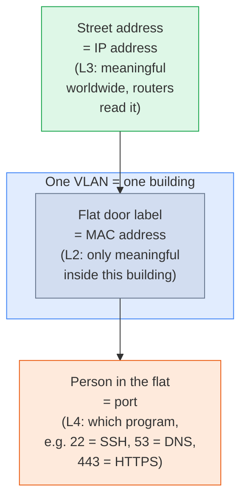
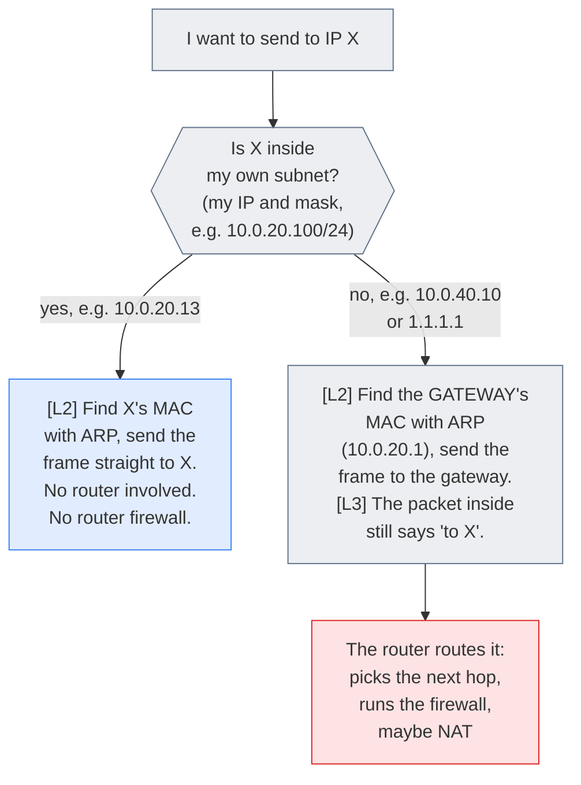
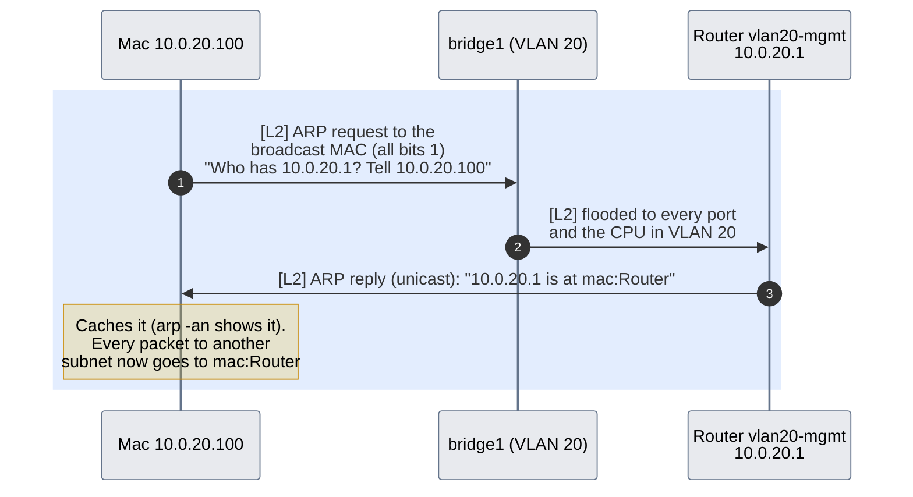

# IP Addressing and Subnetting

Addressing is the part of networking that tells devices where they are and whether a target is local or needs to go through a router.

## The Three Kinds Of Address

A network is a building of flats. One VLAN is one building.



| | MAC address | IP address | Port |
|---|---|---|---|
| Layer | L2 | L3 | L4 |
| Looks like | six pairs of hex digits separated by colons (I never print mine) | `10.0.20.100` | `22`, `53`, `443` |
| Who sets it | Burned into the network card (can be overridden) | DHCP or a static setting | The program that listens or connects |
| Scope | One VLAN (one "broadcast domain") | End to end | One computer |
| Changes on the way? | **Yes, at every router** | No (only NAT changes it) | No (only NAT changes the source port) |

## Private And Public Addresses

Three ranges are set aside for private networks.[^1] They are not routable on the internet, so every home and every lab can reuse them:

```text
10.0.0.0    - 10.255.255.255   (10/8 prefix)
172.16.0.0  - 172.31.255.255   (172.16/12 prefix)
192.168.0.0 - 192.168.255.255  (192.168/16 prefix)
```

Your **public** IP is the one your ISP assigns. It is unique on the internet, and it can change when the router reconnects unless the ISP gives you a static one. The router translates between the two; that is NAT, on [Router Essentials](/pages/networking/basics/router-essentials).

## Subnet Notation

```text
192.168.1.0/24

/24 means the first 24 bits are the network, last 8 are hosts.
Usable range: 192.168.1.1 - 192.168.1.254  (254 hosts)

.0   = network address (not assignable)
.1   = typically the router/gateway
.255 = broadcast address (not assignable)
```

The number after the slash is the prefix length, the CIDR way of writing how big a block is.[^2] A `/24` holds 256 addresses, 254 of them usable.

## Is This Address Next To Me?

Every computer makes the same decision for every packet it sends. It compares the destination with its own address and mask:



The **gateway** is the router's address inside your subnet: the building's front door, where all outgoing post leaves. In my lab it is always `.1`, and DHCP tells each device what it is.

That first branch is the reason for a rule you will see again and again: **traffic inside one VLAN never meets the router's firewall.** Two hosts in VLAN 20 talk directly through the switch. [VLANs & Broadcast Domains](/pages/networking/basics/vlans-and-broadcast-domains) shows what that means for security.

## ARP: Turning An IP Into A MAC

A computer knows the IP it wants, but the L2 envelope needs a MAC. ARP asks the whole VLAN:[^3]



`mac:Router` stands for the router's real MAC address, which I do not print.

ARP is the glue between L2 and L3. It never crosses a router: each VLAN has its own ARP conversations.

A few things worth knowing:

- **The router has one MAC for all its VLAN interfaces.** The VLAN tag, not the MAC, tells the VLANs apart.
- **ARP replies are not authenticated.** A malicious host could answer "10.0.20.1 is at *my* MAC" (ARP spoofing). That is one reason I encrypt and verify every management connection instead of trusting the network.
- **A device checks its new address before using it.** After DHCP, it sends an ARP probe ("does anyone already use this address?") and then an announcement ("this address is at my MAC").[^4] The probe is how macOS can warn that another device is using your IP address.

To see the cache on a Mac: `arp -an | grep 10.0.20.1`. It prints MAC addresses, so keep its output to yourself.

## Example Homelab Address Scheme

My first lab was one flat network behind an ASUS router:

```text
192.168.1.0/24

.1    ASUS Router (gateway)
.20   Proxmox host
.25   OpenWebUI container
.26   Ollama container
.30   NAS / backup storage
.50-.254  DHCP pool (dynamic devices)
```

That kind of predictable layout makes troubleshooting much easier because you can infer what a machine is supposed to be just from the address range.

If `.30` is the shared NAS or backup role in your lab, [TrueNAS SCALE On Proxmox](/pages/services/truenas-scale) and [TrueNAS Shares And Proxmox Integration](/pages/services/truenas-scale/shares-and-proxmox-integration) are the storage-side follow-ups that match this addressing pattern.

## My Address Plan Now

Today every lab address follows one pattern: `10.0.VLAN.host`. Each VLAN is one `/24`, and the third number is the VLAN number, so an address tells you its VLAN at a glance.

| Address | What | VLAN |
|---|---|---|
| `10.0.10.20`, `10.0.10.21` | The two Proxmox nodes | 10 OOBM |
| `10.0.20.1` | The router (every VLAN's `.1` is the router) | 20 MGMT |
| `10.0.20.100` | My admin Mac | 20 MGMT |
| `10.0.40.10`, `10.0.40.11` | The two Pi-holes | 40 SBC |
| `10.0.50.10` | The monitoring board | 50 MONITOR |

The same idea as the flat layout, one level up: the VLAN tells you the kind of device, and the host number tells you which one. [VLANs & Broadcast Domains](/pages/networking/basics/vlans-and-broadcast-domains) lists all ten VLANs.

## IPv6

IPv6 uses 128-bit addresses instead of IPv4's 32-bit space, which solves address exhaustion.[^5]

```text
Example: 2001:0db8:85a3::8a2e:0370:7334
```

The `2001:db8::/32` block is reserved for examples like this one.[^6]

For many homelabs, IPv4 is still enough. If you do enable IPv6, dual stack is the normal transition path so both IPv4 and IPv6 stay available.

## Related Topics

- [Network Words In A Nutshell](/pages/networking/basics/network-words) - MAC, IP, subnet, gateway and ARP in one page.
- [Router Essentials](/pages/networking/basics/router-essentials) - DHCP, which hands out these addresses, and NAT, which hides them.
- [VLANs & Broadcast Domains](/pages/networking/basics/vlans-and-broadcast-domains) - one subnet per VLAN.
- [Linux Bridges in Proxmox](/pages/networking/homelab-network/linux-bridges-proxmox) - the flat layout above, inside a Proxmox host.

[^1]: [RFC 1918, Address Allocation for Private Internets](https://www.rfc-editor.org/rfc/rfc1918), section 3: the three blocks `10/8`, `172.16/12` and `192.168/16`.
[^2]: [RFC 4632, Classless Inter-domain Routing (CIDR)](https://www.rfc-editor.org/rfc/rfc4632) defines the prefix notation.
[^3]: [RFC 826, An Ethernet Address Resolution Protocol](https://www.rfc-editor.org/rfc/rfc826).
[^4]: [RFC 5227, IPv4 Address Conflict Detection](https://www.rfc-editor.org/rfc/rfc5227), section 1.1, defines the ARP Probe (sender IP all zeros) and the ARP Announcement.
[^5]: [RFC 4291, IP Version 6 Addressing Architecture](https://www.rfc-editor.org/rfc/rfc4291): IPv6 addresses are 128 bits.
[^6]: [RFC 3849, IPv6 Address Prefix Reserved for Documentation](https://www.rfc-editor.org/rfc/rfc3849).
