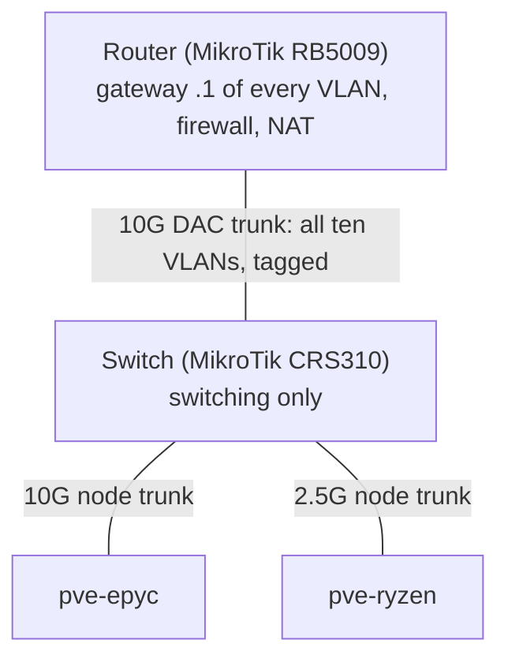
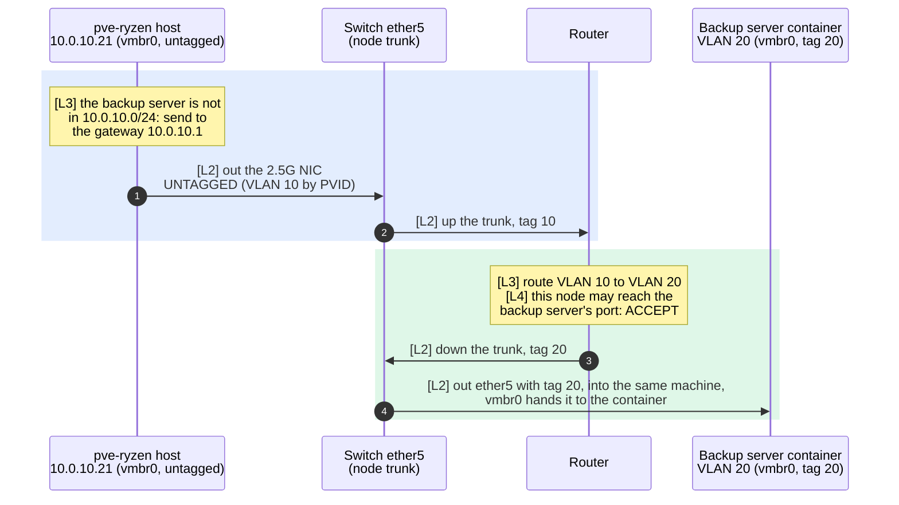
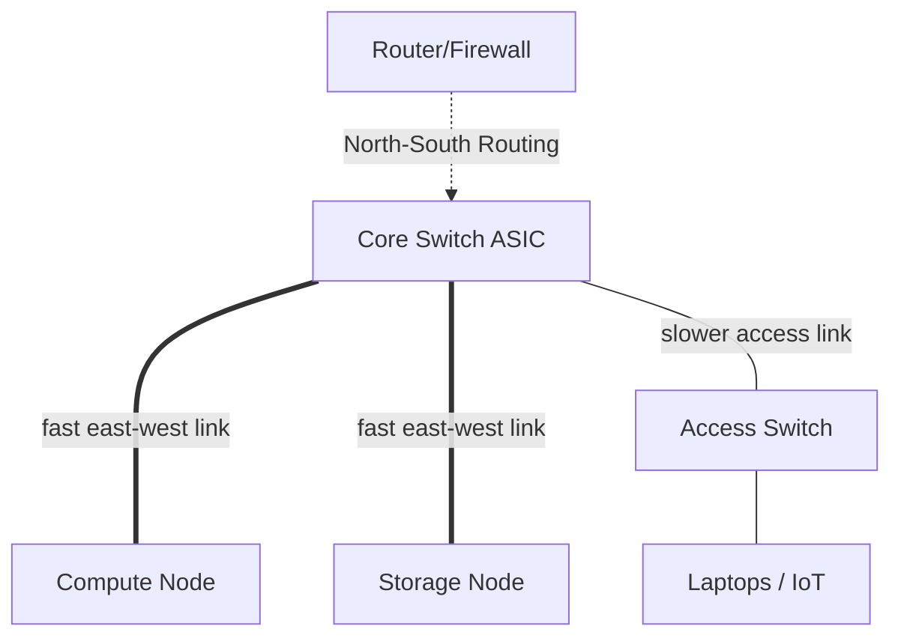

# Network Topologies

The physical layout of switches and routers decides which path traffic takes, especially when it crosses from one VLAN to another.

## North-South And East-West

*   **North-South Traffic:** Data moving in and out of the network (e.g., your laptop accessing the internet, or an external user accessing your Plex server).
*   **East-West Traffic:** Data moving laterally between servers within the network (e.g., your Proxmox compute node pulling a container image from your TrueNAS storage node).

In a homelab with storage and compute on separate machines, east-west is where the big transfers happen: backups, replication, a model loading from the NAS. That is the traffic the layout has to be good at.

## Router-On-A-Stick: What I Run

In a router-on-a-stick design, a single cable (a trunk) connects the switch to the router, and all routing between VLANs happens in the router.

That is my lab. The RB5009 is the only router and holds the gateway of every VLAN. The CRS310 is only a switch. Two hosts in the same VLAN talk through the switch without touching the router; anything that changes VLAN goes up the trunk and comes back down.

The point of it is simple: there is one router, so there is one firewall, and every packet between VLANs passes it.

### The Hairpin

Traffic between two VLANs on the switch goes up the trunk to the router and back down the same cable. [VLANs & Broadcast Domains](/pages/networking/basics/vlans-and-broadcast-domains) follows one such frame across the trunk twice.

The extreme case is a **hairpin**: traffic that leaves a machine and comes back to it through the router. In my design the backup server runs as a container on one of the Proxmox nodes, in VLAN 20, while the node's own address is in VLAN 10. So a backup of that node leaves the machine and comes straight back:

Every byte of that backup crosses the node's 2.5G link twice and the router once. It works, and FastTrack keeps the router's CPU cost low, but it is why big restores take time.

The earlier version of this page said the router would choke on traffic like this. The measurements below say otherwise, at least at the speeds I have.

## What It Really Costs

A link has two speeds. The **port speed** is the most the socket can do. The **negotiated speed** is what the two ends agreed on when the cable went in: the fastest speed both ends support, and the cable can carry. I read the negotiated speeds from both MikroTiks on 13 November 2026:

| Link | Cable | Port speed | Links at |
|---|---|---|---|
| Router `sfp-sfpplus1` to switch `sfp-sfpplus1`: the backbone, all ten VLANs | DAC | 10G | 10 Gb/s |
| Switch `sfp-sfpplus2` to pve-epyc | DAC | 10G | 10 Gb/s |
| Switch `ether5` to pve-ryzen | copper | 2.5G | 2.5 Gb/s |
| Router `ether2` to `ether5`: my Mac, a Tailscale router, the Pi-hole, the proxy | copper | 1G | 1 Gb/s each, except the Pi-hole: 100 Mb/s |
| Switch `ether1` to an unmanaged switch (BMCs, KVM) | copper | 2.5G | 1 Gb/s (the unmanaged switch is 1G) |
| Switch `ether2` to the monitoring board | copper | 2.5G | 2.5 Gb/s |

A **DAC** (direct-attach copper) is a short, thick copper cable with an SFP+ plug moulded onto each end. Inside one rack it does the job of two optical modules and a fibre, for less money and less heat.

Two rows deserve a word:

- **The Pi-hole links at 100 Mb/s, and that is correct.** It runs on a Raspberry Pi 3 Model B, which has 100 Mb/s Ethernet,[^1] so that is its top speed on any port and any cable. A DNS answer is a few hundred bytes, so this costs nothing.
- **My Mac links at 1 Gb/s.** Its USB adapter can do 10G, but the router's `ether2` is a 1G port, so the pair settles on 1G.

A path is as fast as its **slowest link**. I measured two paths end to end, with a raw TCP stream for 8 seconds each way:

| Path | Measured | In MB/s | The slowest link |
|---|---|---|---|
| An apps VM on pve-ryzen to and from the NAS VM on pve-epyc, inside one VLAN | 2.2 to 2.35 Gb/s | about 280 | pve-ryzen's 2.5G port on the switch |
| My Mac to and from the same apps VM, routed by the router | 0.93 Gb/s | about 117 | the router's 1G `ether2` port |

Both paths run at close to the full speed of their slowest link, so the cables, the switch chip and the routed hop cost almost nothing. The VMs use virtio network cards, which have no speed of their own, and the MTU is 1500 on every link.

One honest limit: the routed path was tested at 1 Gb/s, because that is my Mac's port. I have not measured a routed path at 10G.

What this means day to day:

- **10G is used only between the router, the switch and pve-epyc.** Anything that starts or ends on pve-ryzen is capped at 2.5 Gb/s. Both SFP+ cages on the switch are taken, so pve-ryzen's own 10G card stays unplugged until there is a switch with more SFP+ cages.
- **A wired Mac copies to the NAS at about 115 MB/s**, or about 400 GB an hour.
- **Wi-Fi is not measured yet.** Expect it to be the slowest link for phones and laptops.

## Collapsed Core

The usual answer to heavy east-west traffic is a **Collapsed Core**. It collapses the traditional "Core" and "Distribution" network layers into a single high-speed backbone switch.

The router still handles routing between VLANs where a security boundary matters, for example keeping IoT devices away from management. Bulk transfers between compute and storage are kept *inside one VLAN*, so the core switch moves them in hardware and they never touch the router.

My first measured path above is exactly that: VM to NAS inside one VLAN, switched by the switch chip, with no router involved. A collapsed core does the same thing with bigger links.

The design on [Network Segmentation Migration](/pages/networking/homelab-network/enterprise-segmentation-migration) adds a MikroTik CRS510 as that core switch. Today the lab runs without it, and the numbers above say one router is enough at these speeds.

### Routing In The Switch Chip

Some MikroTik switches can route between VLANs in the switch chip itself, which MikroTik calls L3 Hardware Offloading.[^2] Compute and storage can then sit in separate VLANs without the trip to the router.

Two things to check first. Only the models MikroTik lists support it, and some of those lack features such as FastTrack and NAT offloading.[^2] And the routing then happens in the switch, not in the one router where my firewall lives.

## Related Topics

- [VLANs & Broadcast Domains](/pages/networking/basics/vlans-and-broadcast-domains) - a frame across the trunk, hop by hop.
- [Router Essentials](/pages/networking/basics/router-essentials) - what the router does with every packet that changes VLAN.
- [Network Segmentation Migration](/pages/networking/homelab-network/enterprise-segmentation-migration) - the move from a flat network to VLANs.
- [Homelab Drawing Set](/pages/homelab-architecture/drawing-set) - every cable and port, drawn.

[^1]: [Raspberry Pi 3 Model B](https://www.raspberrypi.com/products/raspberry-pi-3-model-b/): "100 Base Ethernet".
[^2]: [MikroTik, L3 Hardware Offloading](https://manual.mikrotik.com/docs/bridging-and-switching/l3-hardware-offloading/): it offloads some router features onto the switch chip, only the devices listed in its table support it, and some of them lack features including FastTrack and NAT connection offloading.
