# Network Words In A Nutshell

New to networking? Read this once, top to bottom, before the other pages in this section.

Each word gets four short lines: what it is, what it is like in everyday life, where it is in my lab, and which page explains it fully. The words are in learning order: each one uses only the words above it. The one-line versions for later are at the end.

The everyday picture is a **building** of flats. One network is one building. The **MAC address** is the label on a flat's door, the **IP address** is the street address, and the **port** is the person inside the flat.

```mermaid
flowchart TB
    subgraph G7["L7: what programs say to each other"]
        DHCP["DHCP<br/>gets you an address"]
        DNS["DNS<br/>names to addresses"]
        NTP["NTP<br/>the right time"]
        HTTP["HTTP / HTTPS<br/>the web"]
        SSH["SSH<br/>remote command line"]
        PRX["Proxy / reverse proxy<br/>middlemen"]
    end
    subgraph GT["Privacy and identity"]
        TLS["TLS<br/>sealed envelope"]
        CERT["Certificate, CA<br/>an ID card"]
        WG["WireGuard, Tailscale<br/>private tunnels"]
        DERP["DERP<br/>relay"]
    end
    subgraph G4["L4: which program, and how reliably"]
        PORT["Port<br/>which program"]
        TCP["TCP<br/>a phone call"]
        UDP["UDP<br/>a postcard"]
        CT["Connection tracking<br/>the router's memory"]
    end
    subgraph G3["L3: between networks"]
        IP["IP address<br/>street address"]
        GW["Gateway, router<br/>the post office"]
        FW["Firewall<br/>the guard"]
        NAT["NAT, masquerade<br/>the return address"]
        ICMP["ICMP, ping<br/>a knock"]
    end
    subgraph G2["L2: inside one network"]
        MAC["MAC address<br/>door label"]
        SW["Switch<br/>the porter"]
        VLAN["VLAN<br/>separate buildings"]
        ARP["ARP<br/>who lives at this address?"]
    end
    G7 --> GT --> G4 --> G3 --> G2
    style G7 fill:#eab30826,stroke:#ca8a04
    style GT fill:#a855f726,stroke:#a855f7
    style G4 fill:#f9731626,stroke:#ea580c
    style G3 fill:#22c55e26,stroke:#16a34a
    style G2 fill:#3b82f626,stroke:#3b82f6
```

The tags in square brackets, such as `[L2]`, say at which layer a word lives. [OSI Model](/pages/networking/basics/osi-model) explains the layers.

## Addresses: Who Is Who

### MAC Address

`[L2]` **Media Access Control address**

- **In a nutshell:** the hardware address of a network card, set at the factory: six pairs of hexadecimal digits. It only means something inside one local network (one VLAN). Switches use it to deliver a frame to the right device, and every router hop replaces it.
- **Think of it as:** the label on a flat's door. The building's porter uses it; nobody in the next town has heard of it.
- **In my lab:** my Mac's network adapter has one, and so does each VLAN interface of the router. The DHCP server recognises machines by their MAC, which is why I treat MACs as secrets and never print one on these pages.
- **More:** [IP Addressing and Subnetting](/pages/networking/basics/ip-addressing-subnetting).

### IP Address

`[L3]` **Internet Protocol address**

- **In a nutshell:** a device's address on the network, four numbers from 0 to 255, like `10.0.20.100`. It is given to the device (by DHCP or by hand), and it stays the same from the sender to the final destination, so every router on the way can read it. Addresses starting with `10.`, `192.168.` or `172.16.` to `172.31.` are **private**: fine at home, never carried across the internet.
- **Think of it as:** a full street address. Any post office in the world can route a letter by it.
- **In my lab:** every lab address is private and follows one pattern, `10.0.VLAN.host`: the Pi-hole `10.0.40.10` lives in VLAN 40. The internet only ever sees my provider's public address (see NAT below).
- **More:** [IP Addressing and Subnetting](/pages/networking/basics/ip-addressing-subnetting).

### Subnet And Mask (`/24`)

`[L3]`

- **In a nutshell:** a block of neighbouring IP addresses whose devices talk to each other directly. `10.0.20.0/24` means "the first 24 bits (`10.0.20`) name the network, the last 8 bits name the host", so `.1` to `.254` are usable. For every packet, a device uses the mask to decide: is this address next to me, or must it go to the router?
- **Think of it as:** the range of flat numbers in one building. Neighbours walk to each other's door; anyone else needs the post.
- **In my lab:** each VLAN is one `/24` subnet: VLAN 20 is `10.0.20.0/24`, VLAN 40 is `10.0.40.0/24`.
- **More:** [IP Addressing and Subnetting](/pages/networking/basics/ip-addressing-subnetting).

### Gateway

`[L3]` **also called the default gateway**

- **In a nutshell:** the router's address inside your subnet. A device sends every packet whose destination is outside its own subnet to the gateway, and the router takes it from there.
- **Think of it as:** the building's front door, where all outgoing post leaves.
- **In my lab:** always `.1`, and always the router: `10.0.20.1` in VLAN 20, `10.0.40.1` in VLAN 40. DHCP tells each device its gateway.
- **More:** [IP Addressing and Subnetting](/pages/networking/basics/ip-addressing-subnetting).

### Port

`[L4]`

- **In a nutshell:** a number from 0 to 65535 that picks which program on a computer gets the data. Servers listen on well-known ports; the client side picks a random high one. Written `10.0.40.10:22` or `tcp/22`. Not to be confused with a **switch port**, which is a socket you plug a cable into (`ether2`).
- **Think of it as:** the person inside the flat. Same street address, different recipients.
- **In my lab:** 22 SSH, 53 DNS, 67/68 DHCP, 123 NTP, 443 HTTPS, 8006 Proxmox UI, 8291 WinBox, 3128 Squid, 3142 apt-cacher-ng. Most firewall rules say "this source may reach that port".
- **More:** [TCP/IP Protocols](/pages/networking/basics/tcp-ip-protocols).

## Inside One Network (L2)

### Switch And Bridge

`[L2]`

- **In a nutshell:** a box with many ports that connects the devices of one local network. It reads only the destination MAC address of each frame and sends it out of the right port; it learns who is behind which port by watching traffic. It changes nothing and knows nothing about IP addresses. MikroTik's RouterOS calls a switch a **bridge**.
- **Think of it as:** the building's porter, who knows which door is where but never reads the street address.
- **In my lab:** the MikroTik CRS310 is only a switch for my traffic. The router contains one too: `bridge1`, which joins its ether ports and the 10G link.
- **More:** [Router Essentials](/pages/networking/basics/router-essentials).

### VLAN

`[L2]` **Virtual LAN**

- **In a nutshell:** a way to split one switch and one cable into several separate networks. Each frame carries a VLAN number (the **tag**), and the switch keeps the numbers apart, so devices in different VLANs can only reach each other through a router and its firewall. A **trunk** link carries many VLANs (tagged); an **access** port belongs to exactly one (untagged).
- **Think of it as:** separate buildings that share the same roads and pipes. Visiting another building means going through the post office.
- **In my lab:** ten VLANs, 10 to 90, one per kind of device: 10 OOBM (Proxmox hosts, BMCs), 20 MGMT (my Mac), 40 SBC (the Pis), 70 CLIENT (Wi-Fi phones and laptops), 75 GUEST, 80 IOT and so on. The 10G link between the router and the switch is a trunk carrying all of them.
- **More:** [VLANs & Broadcast Domains](/pages/networking/basics/vlans-and-broadcast-domains).

### Broadcast

`[L2]`

- **In a nutshell:** one message for every device in the local network at once, sent to the special "everyone" MAC address (all bits set to 1). Devices use it when they do not yet know whom to ask. A broadcast never crosses a router.
- **Think of it as:** an announcement over the building's loudspeaker: every flat in this building hears it, the next building does not.
- **In my lab:** ARP questions and the first DHCP message are broadcasts. A broadcast in VLAN 70 (Wi-Fi) never reaches VLAN 10.
- **More:** [VLANs & Broadcast Domains](/pages/networking/basics/vlans-and-broadcast-domains).

### ARP (Address Resolution Protocol)

`[L2]` `[L3]`

- **In a nutshell:** how a device finds the MAC address that belongs to an IP address in its own network. It broadcasts "Who has `10.0.20.1`?", the owner answers "I do, here is my MAC", and the answer is cached for a few minutes. It is the glue between L2 and L3.
- **Think of it as:** knocking on every door in the building: "Who gets the post for this street address?" The right flat opens its door.
- **In my lab:** before my Mac sends anything to another subnet, it asks for its gateway `10.0.20.1` and caches the router's answer. `arp -an` shows the cache (it prints MAC addresses, so keep its output to yourself).
- **More:** [IP Addressing and Subnetting](/pages/networking/basics/ip-addressing-subnetting).

## Between Networks (L3)

### Router And Routing

`[L3]`

- **In a nutshell:** a router connects different networks and moves packets between them, choosing the next hop by the destination IP address. That choice is **routing**. At every hop the router puts the packet into a new L2 envelope (new MAC addresses) and lowers its hop counter (TTL) by one.
- **Think of it as:** the post office between buildings. It reads the street address, ignores the door label, and writes a new label for the next leg.
- **In my lab:** a MikroTik RB5009 is the only router. It owns `.1` in every VLAN plus its WAN address on `ether1`, so every packet between VLANs, or out to the internet, passes through it and its firewall.
- **More:** [Router Essentials](/pages/networking/basics/router-essentials).

### LAN And WAN

`[L3]`

- **In a nutshell:** the **LAN** (Local Area Network) is the inside, the networks you control. The **WAN** (Wide Area Network) is the outside, towards the internet. A home router sits between the two.
- **Think of it as:** the private grounds and the public road outside the gate.
- **In my lab:** the router's `ether1` is the WAN port. Since 16 November 2026 it faces the provider's fibre box directly and gets a public address from the provider by DHCP. Every other port and VLAN is LAN.
- **More:** [Router Essentials](/pages/networking/basics/router-essentials).

### Firewall

`[L3]` `[L4]`

- **In a nutshell:** a list of rules that decides which packets may pass, by source and destination address, port, the interface a packet came in on, and the state of its connection. Rules are read top to bottom and the first match decides. A **stateful** firewall remembers conversations, so answers to an allowed request come back by themselves.
- **Think of it as:** a guard at the post office with a list of who may send what to whom.
- **In my lab:** the router's firewall starts every VLAN from "drop" and ends each chain with a drop that it logs. The switch has a small one that guards its own management.
- **More:** [Router Essentials](/pages/networking/basics/router-essentials).

### NAT (Network Address Translation)

`[L3]` `[L4]`

- **In a nutshell:** rewriting the addresses (and sometimes the ports) in packets as they pass a router. Mostly it lets a whole private network share one public address: outgoing packets get the router's address as their source, the router remembers each swap, and it hands every reply back to the right device.
- **Think of it as:** a company post room that sends every letter with the company's return address and keeps a log, so each reply reaches the right desk.
- **In my lab:** the router NATs everything that leaves through `ether1`. Because of it, nothing on the internet can start a conversation with a `10.0.x.y` address.
- **More:** [Router Essentials](/pages/networking/basics/router-essentials).

### Masquerade And SNAT

`[L3]` `[L4]`

- **In a nutshell:** **SNAT** (source NAT) replaces a packet's source address. **Masquerade** is the kind of source NAT that uses "whatever address the outgoing interface has right now", so it keeps working when that address comes from DHCP and changes.
- **Think of it as:** always writing the return address that is on the front door today, even after the company moves.
- **In my lab:** the router masquerades out of `ether1`, because the provider hands out its WAN address by DHCP and it could change. The Tailscale routers use SNAT the other way round: tailnet traffic enters the lab with the address of the router it came through (`10.0.20.10` or `10.0.20.13`) as its source, so lab hosts send their answers back to it.
- **More:** [Router Essentials](/pages/networking/basics/router-essentials).

### Double NAT

`[L3]`

- **In a nutshell:** two NATs in a row, your router's and then your ISP's. Going out works fine. Coming in, and setting up direct device-to-device connections, usually does not.
- **Think of it as:** two post rooms in a row, each rewriting the return address.
- **In my lab:** not any more. Until 16 November 2026 the provider's router sat in front of mine and did a second NAT, and Tailscale had to relay. Since the WAN went direct, my router's masquerade is the only NAT.
- **More:** [Router Essentials](/pages/networking/basics/router-essentials).

### ICMP And Ping

`[L3]` **Internet Control Message Protocol**

- **In a nutshell:** the network's control messages: "are you there?" and "yes" (echo request and reply, which is what `ping` sends), "cannot reach that address", "too many hops" (which `traceroute` uses). ICMP has no ports. A reply proves the target is up and the path passes ICMP, not that the service you want (a port) is reachable.
- **Think of it as:** knocking on a door. An answer means someone is home, not that the shop inside is open.
- **In my lab:** the router answers pings to its own addresses (rate-limited), so "the gateway answers" proves little. Ping between most VLANs is dropped, and so is ping through Tailscale. I test a service with its port instead: `nc -vz 10.0.10.20 8006`.
- **More:** [TCP/IP Protocols](/pages/networking/basics/tcp-ip-protocols).

## Conversations (L4)

### TCP (Transmission Control Protocol)

`[L4]`

- **In a nutshell:** a reliable conversation between two programs. It opens with a three-step handshake (SYN, SYN-ACK, ACK), numbers every byte, re-sends anything lost, delivers everything in order, and closes politely (FIN).
- **Think of it as:** a phone call. You dial, they pick up, you both say hello, and you notice when the line drops.
- **In my lab:** SSH (22), HTTPS (443), WinBox (8291) and the Proxmox UI (8006) all use TCP.
- **More:** [TCP/IP Protocols](/pages/networking/basics/tcp-ip-protocols).

### UDP (User Datagram Protocol)

`[L4]`

- **In a nutshell:** fire and forget. No handshake, no delivery guarantee, no order. It is fast and simple, and the program itself asks again if an answer does not come.
- **Think of it as:** a postcard. You post it and hope; there is no receipt.
- **In my lab:** DNS (53), DHCP (67/68), NTP (123) and WireGuard (Tailscale's tunnels) use UDP. The firewall still treats a UDP reply as part of the same conversation.
- **More:** [TCP/IP Protocols](/pages/networking/basics/tcp-ip-protocols).

### Connection Tracking (conntrack)

`[L4]`

- **In a nutshell:** the router's memory of every conversation passing through it: who talks to whom, on which ports, and in which state (`new`, `established`, `related`, `invalid`). It is what makes a firewall stateful, and what makes NAT possible (each reply is looked up to undo the swap).
- **Think of it as:** the guard's visitor log. Replies are let in because they match an entry in today's log.
- **In my lab:** the router's first rules accept `established` and `related` packets, so the rest of the firewall only judges the first packet of each conversation. **FastTrack**, RouterOS's express lane, then sends established traffic past most of the firewall, so downloads run at full speed.
- **More:** [TCP/IP Protocols](/pages/networking/basics/tcp-ip-protocols).

## The Services Every Device Uses (L7)

### DHCP (Dynamic Host Configuration Protocol)

`[L7]`

- **In a nutshell:** how a device gets its network settings when it joins: an IP address, the subnet mask, the gateway, the DNS server and how long it may keep them (the **lease**). It takes four messages: Discover, Offer, Request, Acknowledge ("DORA").
- **Think of it as:** a hotel reception desk. You walk in and get a room number, the Wi-Fi details and where breakfast is.
- **In my lab:** the router is the DHCP server in every VLAN that has a pool. Physical machines get a **static lease** (their MAC always gets the same address), which is why my Mac always gets `10.0.20.100`. Containers and VMs set their own fixed address instead.
- **More:** [Router Essentials](/pages/networking/basics/router-essentials).

### DNS (Domain Name System)

`[L7]`

- **In a nutshell:** the internet's phone book. It turns names like `debian.org` into IP addresses. Your device asks a DNS server, which asks others when it does not know the answer, and remembers answers for a while.
- **Think of it as:** the contacts app on your phone. You tap a name and it dials the number.
- **In my lab:** DHCP tells every VLAN to ask the Pi-holes: the shared address `10.0.40.254` first, then `10.0.40.11`. They block ad and tracker names, answer the lab's own names themselves, and ask Quad9 (`9.9.9.9`) for everything else.
- **More:** [DNS Fundamentals](/pages/networking/basics/dns-fundamentals).

### NTP (Network Time Protocol)

`[L7]`

- **In a nutshell:** keeps clocks right by asking a time server (UDP 123). It matters more than it seems: certificates, logs and backups all go wrong when a clock is off.
- **Think of it as:** setting your watch by the station clock.
- **In my lab:** the router answers time requests in every VLAN, even the VLANs that cannot reach the internet.
- **More:** [Router Essentials](/pages/networking/basics/router-essentials).

### HTTP And HTTPS

`[L7]` `[TLS]`

- **In a nutshell:** **HTTP** is the language of the web: a browser sends a request ("give me this page") and the server sends a response. **HTTPS** is the same conversation inside TLS: encrypted, with the server's identity checked. The usual ports are 80 and 443.
- **Think of it as:** HTTP is a postcard anyone on the way can read; HTTPS is the same message in a sealed envelope.
- **In my lab:** the Proxmox UI (`https://10.0.10.20:8006`), downloads through the proxy, and Caddy on 443 for the lab's own names.
- **More:** [Router Essentials](/pages/networking/basics/router-essentials).

### SSH (Secure Shell)

`[L7]`

- **In a nutshell:** an encrypted remote command line (TCP 22). You type commands on another computer as if you sat at it. The first time you connect, SSH remembers the server's key, and it warns you if the key ever changes.
- **Think of it as:** a remote control for a computer, over a private line.
- **In my lab:** I SSH from my Mac into the Pis and the Proxmox hosts. Ansible uses SSH to set them up, and to run a few commands on the MikroTiks.
- **More:** [TCP/IP Protocols](/pages/networking/basics/tcp-ip-protocols).

### API (Application Programming Interface)

`[L7]`

- **In a nutshell:** a door for programs rather than people: structured commands and answers instead of a screen to click.
- **Think of it as:** a trade counter for bulk orders, next to the shop floor for customers.
- **In my lab:** Ansible changes the router and the switch through the RouterOS API over TLS, and refuses to talk unless the router's certificate checks out. Proxmox has an API too, on 8006.
- **More:** [The Lab Is Built From Code](/pages/homelab-architecture/decisions/lab-as-code).

### Proxy

`[L7]` **also called a forward proxy**

- **In a nutshell:** a middleman that fetches things on behalf of other machines. The client asks the proxy, the proxy fetches from the internet and passes the answer back. A proxy can allow only a list of sites, and can keep copies of downloads (a cache).
- **Think of it as:** a runner with a shopping list. You cannot leave the building, but they fetch anything on the list.
- **In my lab:** a Raspberry Pi at `10.0.40.19`: Squid on 3128 with an allowlist of domains (`.debian.org`, `.docker.io`, ...) and apt-cacher-ng on 3142, a cache for `apt`. It is the only way to the internet for hosts in OOBM, SBC, MONITOR and STORAGE.
- **More:** [DNS Fundamentals](/pages/networking/basics/dns-fundamentals).

### Reverse Proxy

`[L7]` `[TLS]`

- **In a nutshell:** a server that stands in front of other servers and receives requests for them. It handles HTTPS, picks the right server behind it by the name that was asked for, and passes the request on. A forward proxy helps clients get out; a reverse proxy helps them get in.
- **Think of it as:** a receptionist in front of many offices. Visitors only ever talk to reception.
- **In my lab:** Caddy (a container on the second Proxmox node, `10.0.20.12`) answers the lab's names with one wildcard certificate and passes each one to the right web UI.
- **More:** [One Certificate, One Front Door](/pages/homelab-architecture/decisions/one-certificate).

## Privacy, Identity And Tunnels

### Encryption And Keys

`[TLS]`

- **In a nutshell:** encryption scrambles data so only someone with the right key can read it. Modern systems use a **key pair**: a **public key** you can give to anyone and a **private key** you never share. What one locks, only the other opens. A **signature** made with the private key can be checked by anyone who has the public key.
- **Think of it as:** handing out open padlocks (public keys) while keeping the only key (the private key) in your pocket.
- **In my lab:** SSH, TLS and WireGuard all use key pairs. The routers' private keys never leave the routers.
- **More:** [One Certificate, One Front Door](/pages/homelab-architecture/decisions/one-certificate).

### TLS (Transport Layer Security)

`[TLS]` **formerly called SSL**

- **In a nutshell:** the standard way to make a TCP connection private and to prove who the server is. A handshake checks the server's certificate and agrees on keys; after that, everything is encrypted. It is the S in HTTPS.
- **Think of it as:** a sealed, tamper-evident envelope, handed over only after the courier has checked the recipient's ID.
- **In my lab:** the RouterOS API on both MikroTiks, the Proxmox UI, and Caddy.
- **More:** [OSI Model](/pages/networking/basics/osi-model).

### Certificate And CA

`[TLS]` **CA = Certificate Authority**

- **In a nutshell:** a **certificate** is a signed statement, "this public key belongs to this name or IP address", valid until a date. A **CA** is an issuer whose signature you trust. A client accepts a certificate only if a CA it trusts signed it and the name matches the one it asked for.
- **Think of it as:** a passport: a photo (the key) and a name, stamped by a passport office (the CA) everyone recognises.
- **In my lab:** each MikroTik signs its own API certificate with its own CA, and Ansible checks the router against a copy of that CA. Caddy has one Let's Encrypt certificate for all the lab's names, proved with a DNS record.
- **More:** [One Certificate, One Front Door](/pages/homelab-architecture/decisions/one-certificate).

### VPN And Tunnel

`[L3]`

- **In a nutshell:** a **tunnel** wraps one network's packets inside another network's packets, usually encrypted, so two places act as if they shared one private network. A **VPN** (Virtual Private Network) is a tunnel used for exactly that: reaching your home or work network across the internet.
- **Think of it as:** a sealed tube between two buildings, laid under the public streets.
- **In my lab:** Tailscale is my VPN. On the road, my Mac reaches `10.0.10.20` through an encrypted tunnel to one of the two Tailscale routers at home.
- **More:** [Tailscale, And No Open Ports](/pages/homelab-architecture/decisions/remote-access).

### WireGuard

`[L3]` `[L4]`

- **In a nutshell:** a modern, small and fast VPN protocol. Each device has a key pair, and packets travel encrypted over UDP. There is no login: a packet sealed with a key the other side knows gets an answer, and anything else is silently ignored.
- **Think of it as:** a tube that only opens for parcels sealed with a key it already knows.
- **In my lab:** I never set WireGuard up by hand. Tailscale creates the keys and builds the tunnels.
- **More:** [Tailscale ZTNA & Subnet Routing](/pages/networking/homelab-network/tailscale-ztna).

### Tailscale And The ACL

`[L3]` `[L7]`

- **In a nutshell:** a service that builds WireGuard tunnels between your devices for you. Your devices together form your **tailnet**, and every device belongs to an identity (your login). The **ACL** (access control list) is the tailnet's rulebook: which identity may reach which address and port.
- **Think of it as:** a private club with membership cards. Members' tubes connect directly, and the club rules say who may enter which room.
- **In my lab:** the ACL lets only my admin accounts reach the lab, and only the two management subnets `10.0.10.0/24` and `10.0.20.0/24`, never all of `10.0.0.0/8`.
- **More:** [Tailscale, And No Open Ports](/pages/homelab-architecture/decisions/remote-access).

### Subnet Router

`[L3]`

- **In a nutshell:** a tailnet device that forwards traffic between the tailnet and a local network (a subnet), so your other devices can reach machines that do not run Tailscale themselves.
- **Think of it as:** the club's side door into an old building whose rooms have no club door of their own.
- **In my lab:** two routers offer the same two subnets: a Raspberry Pi, `ts-sbc` (`10.0.20.13`), and a container, `ts-lxc` (`10.0.20.10`), so one can take over from the other. My Mac must accept the routes: `tailscale set --accept-routes=true --exit-node=` (subnets on, exit node off).
- **More:** [Tailscale ZTNA & Subnet Routing](/pages/networking/homelab-network/tailscale-ztna).

### Exit Node

`[L3]`

- **In a nutshell:** a tailnet device that carries **all** your internet traffic, not just traffic for the lab. Websites then see the exit node's internet address. You switch it on when you want it, for example on public Wi-Fi.
- **Think of it as:** having all your post forwarded through your home address.
- **In my lab:** both Tailscale routers offer one. I keep the Mac's exit node set to **None** unless I want it: reaching the lab needs only the subnet routes, and with an exit node selected, a new network (a phone hotspot) can be left with no DNS and no internet until the tunnel is up.
- **More:** [Tailscale, And No Open Ports](/pages/homelab-architecture/decisions/remote-access).

### DERP (Tailscale's Relay)

`[L7]` **Designated Encrypted Relay for Packets**

- **In a nutshell:** Tailscale's relay servers. When two devices cannot connect directly (for example behind double NAT), their encrypted WireGuard packets travel through a DERP server instead. It cannot read them; it only passes them on. Slower, but it always works.
- **Think of it as:** a forwarding office that passes on sealed parcels it cannot open.
- **In my lab:** behind the old double NAT, my Mac and `ts-sbc` could not connect directly, so the tunnel went through a relay: `tailscale ping ts-sbc` answered "via DERP". The same command tells you whether a tunnel is direct or relayed. After a quiet spell, the first connection can take a few seconds.
- **More:** [Tailscale ZTNA & Subnet Routing](/pages/networking/homelab-network/tailscale-ztna).

## A Few More Words

The one-line versions of words the pages in this section use along the way.

| Word | Layer | Meaning |
|---|---|---|
| **802.1Q** | L2 | The standard for VLAN tags in an Ethernet frame |
| **Access port** | L2 | A switch port in exactly one VLAN, untagged on the wire |
| **Bond / LACP (802.3ad)** | L2 | Two cables acting as one link |
| **CIDR, /24** | L3 | How big a subnet is: `/24` = 256 addresses, 254 usable |
| **DAC (direct-attach copper)** | L1 | A short copper cable with an SFP+ plug moulded on each end |
| **Drop vs reject** | L3/L4 | Drop is silent, so the sender times out. Reject answers. My lab drops |
| **FastTrack** | L4 | RouterOS's fast path for established connections: skips most of the firewall |
| **frame-types** | L2 | What a MikroTik bridge port accepts: tagged only, untagged only, or both |
| **Gratuitous ARP** | L2 | An unasked ARP announcement: "this IP is now at my MAC" |
| **Hairpin** | L2/L3 | Traffic that leaves a machine and comes back to it through the router |
| **Hardware offload** | L2 | The switch chip forwards frames without the CPU |
| **Lease (dynamic / static)** | L7 | An address handed out by DHCP; static means fixed to a MAC |
| **OOBM** | none | Out-of-band management: BMCs and hypervisors, VLAN 10 in my lab |
| **PVID** | L2 | The VLAN an untagged frame entering a port belongs to |
| **SFP+** | L1 | A cage for a 10G plug-in module or a DAC |
| **Switch chip** | L2 | The hardware inside a MikroTik that switches frames at full speed |
| **Tag** | L2 | The VLAN ID carried in a frame on a trunk |
| **TTL** | L3 | A hop counter, lowered by 1 at each router; stops packets looping forever |
| **Trunk** | L2 | A port or link carrying many VLANs, tagged |
| **VIP** | L3 | A virtual IP that can move between hosts, like the shared Pi-hole address |
| **vlan-filtering** | L2 | The MikroTik bridge setting that makes VLANs real; off means one flat network |

## Related Topics

- [Networking Basics](/pages/networking/basics) - the section overview and reading order.
- [OSI Model](/pages/networking/basics/osi-model) - the layers these words live in.
- [Homelab Drawing Set](/pages/homelab-architecture/drawing-set) - the lab these examples come from, drawn sheet by sheet.
