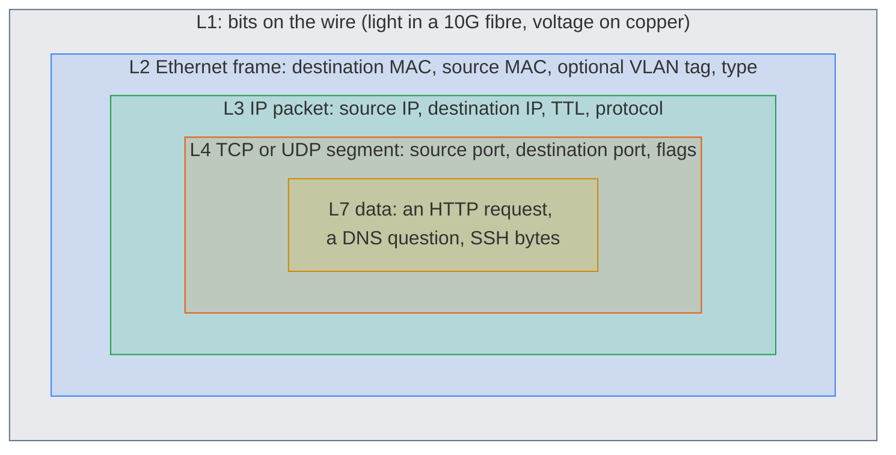
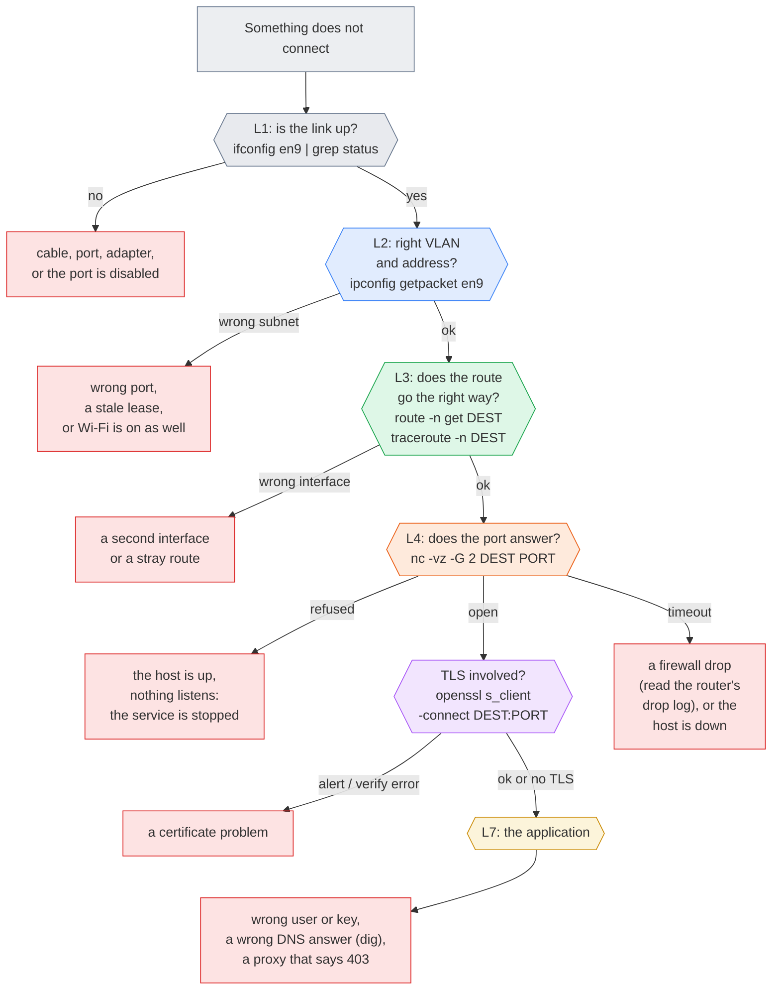

# OSI Model

Sending data over a network is like sending a letter inside several envelopes. Each envelope is handled by a different "post office" that only reads its own envelope:

- The **innermost** content is the actual message (a web page request, a DNS question).
- Around it, an envelope says **which program** on the destination should get it (the **port**: L4).
- Around that, an envelope says **which computer**, anywhere in the world (the **IP address**: L3).
- Around that, an envelope says **which device on this wire, right now** (the **MAC address**: L2).
- And the whole thing travels as **light or electricity** (L1).

This wrapping is called **encapsulation**:

## The Most Important Rule

<Callout type="tip">

The **IP addresses** (L3) stay the same from the first hop to the last, except where NAT changes them on purpose. The **MAC addresses** (L2) are rewritten at **every router hop**, because a MAC address only means something on one wire (one VLAN). A switch never rewrites anything; it only reads the L2 envelope and picks an output port.

</Callout>

Every other page in this section leans on that rule. [Router Essentials](/pages/networking/basics/router-essentials) follows one web request out of the house and shows the envelopes changing hop by hop.

## Seven Layers On Paper, Five In Practice

The textbook model has seven layers (OSI). Real networks use five of them, and layers 5 and 6 fold into "TLS".

| Layer | Name | Unit | Address | Device that works at this layer | Example in my lab |
|---|---|---|---|---|---|
| L1 | Physical | bits | none | cable, SFP+ module, DAC | The 10G DAC between the router's `sfp-sfpplus1` and the switch's `sfp-sfpplus1` |
| L2 | Data link | frame | MAC (48 bits) | switch, bridge | The switch forwarding a frame from `ether2` to `sfp-sfpplus1`, adding VLAN tag 50 |
| L3 | Network | packet | IP (32 bits) | router | The router moving a packet from VLAN 20 to VLAN 40 |
| L4 | Transport | segment (TCP) / datagram (UDP) | port (16 bits) | stateful firewall | The router allowing `tcp/22` to the Pi-hole, and remembering the connection |
| TLS | Session / presentation | record | certificate | none in the middle: it runs end to end | Ansible checking the router's API certificate |
| L7 | Application | message | names, URLs | servers, clients, proxies | DNS on the Pi-hole, Squid on the proxy, SSH, WinBox |

The router is a MikroTik RB5009 and the switch a MikroTik CRS310. [Networking Basics](/pages/networking/basics) introduces the rest of the cast.

## The Layer Tags On These Pages

Every arrow in a sequence diagram in this section starts with a tag that says at which layer it happens. The coloured bands behind the arrows use the same colours.

| Tag | Layer | What it is about | Colour |
|---|---|---|---|
| `[L1]` | Physical | Light in a fibre, voltage on copper, link up or down | grey |
| `[L2]` | Data link | Ethernet frames, MAC addresses, switches, **VLAN tags** | blue |
| `[L3]` | Network | IP addresses, subnets, **routing**, the **firewall's address rules** | green |
| `[L4]` | Transport | TCP and UDP, **ports**, connection tracking (stateful firewall) | orange |
| `[TLS]` | Between L4 and L7 | Encryption and identity (certificates) | purple |
| `[L7]` | Application | DHCP, DNS, HTTP, SSH, NTP, the RouterOS API | yellow |

The coloured bands are a visual aid. The tag in the text is the reliable part.

## Which Layer Broke?

The important practical point is that failures usually map to a layer. A DNS issue is not the same class of problem as a dropped TCP connection or a broken cable.

When something does not work, **climb the layers from the bottom**. Each layer depends on the ones below it, so the first layer that fails is where the problem is.

These are the commands I run on my Mac, where `en9` is its USB network adapter. Yours will have another name; `ifconfig` lists them.

The symptom alone often tells you the layer:

| What you see | Layer | Meaning |
|---|---|---|
| Hangs, then **timeout** | L3/L4 | A firewall **dropped** the packets, or the host is down or unreachable |
| **Connection refused** immediately | L4 | You reached the host; nothing listens on that port |
| **Handshake failure** (for example TLS alert 40) | TLS | You reached the service; it cannot do TLS the way you need (no certificate bound, or no cipher suite in common) |
| **Certificate verify failed** | TLS | It presented a certificate you do not trust: the wrong CA, the wrong name or IP, or expired |
| **Permission denied**, or the login fails | L7 | Everything below works; the user, password or key is wrong |

[Network Troubleshooting](/pages/networking/homelab-network/network-troubleshooting) has the practical checks for containers and VMs on Proxmox.

## Related Topics

- [Network Words In A Nutshell](/pages/networking/basics/network-words) - every word on this page, with an everyday comparison.
- [IP Addressing and Subnetting](/pages/networking/basics/ip-addressing-subnetting) - the three kinds of address, one per layer.
- [TCP/IP Protocols](/pages/networking/basics/tcp-ip-protocols) - what happens at L4.
- [Router Essentials](/pages/networking/basics/router-essentials) - the envelopes changing hop by hop.
- [Network Troubleshooting](/pages/networking/homelab-network/network-troubleshooting) - fixing real faults.
