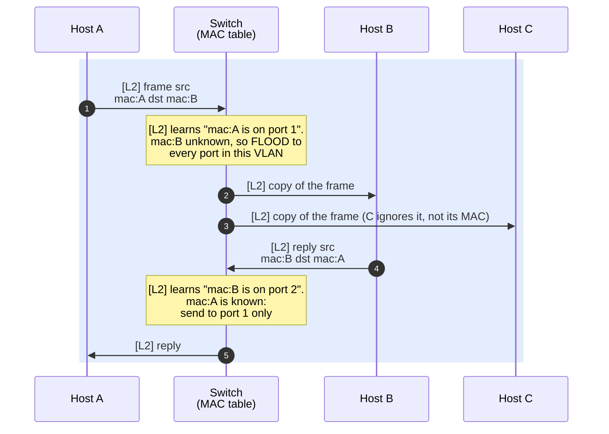
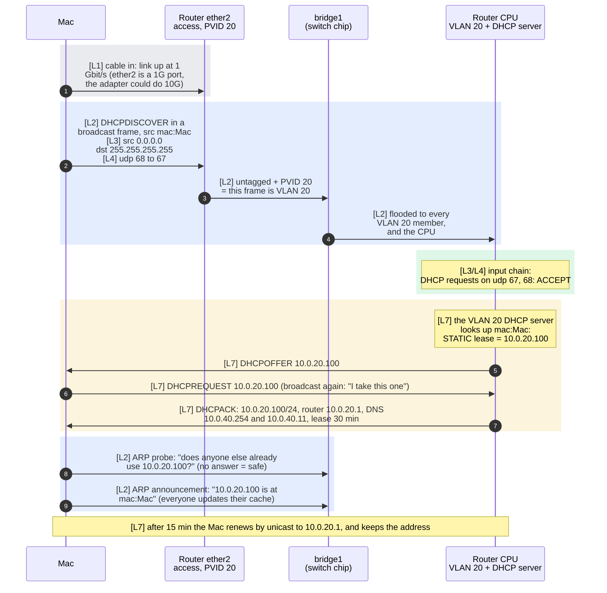
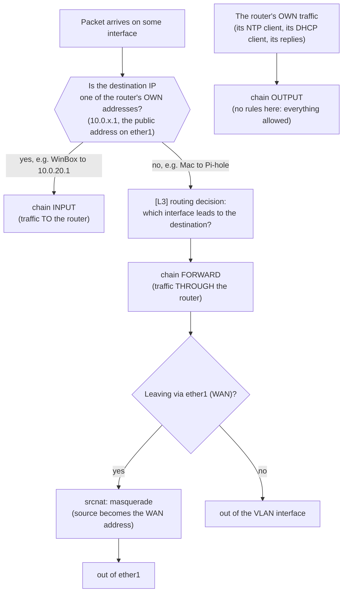
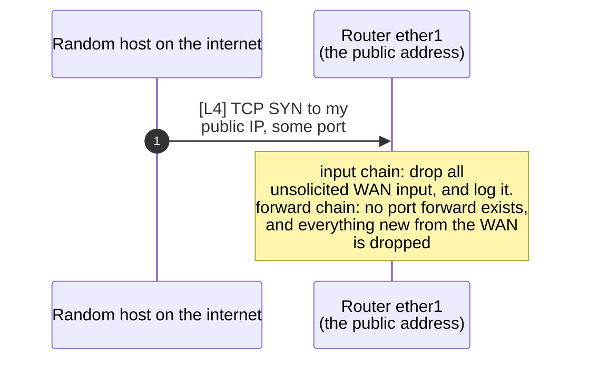
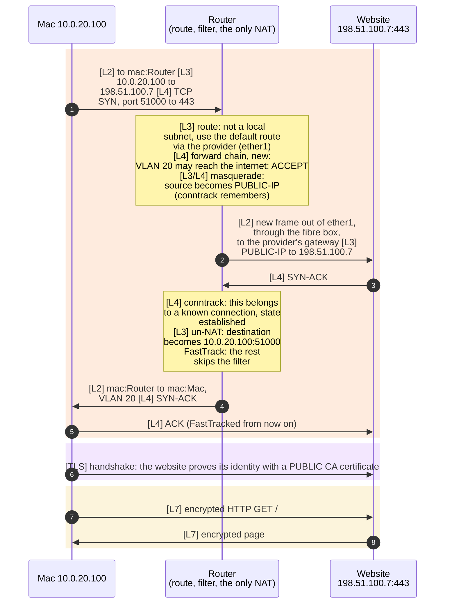
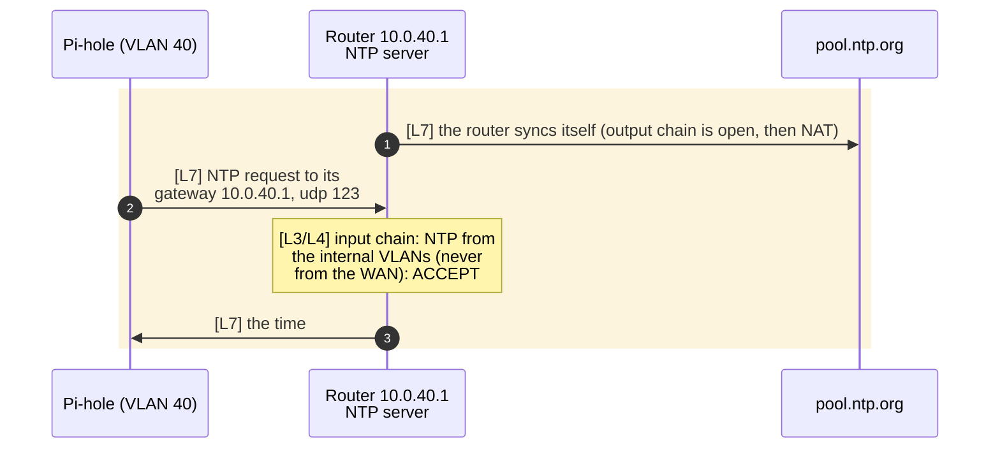

# Router Essentials

The router is the gateway between your private local network and the internet. In a homelab it is usually doing several jobs at the same time.

In my lab that router is a MikroTik RB5009. It owns the `.1` address in every VLAN, so every packet that changes VLAN or leaves the house passes through it:

```text
Internet <-> [RB5009] <-> Your Devices
               |
               |- Routing: moves packets between VLANs and out to the internet
               |- DHCP Server: assigns IP addresses to devices
               |- Firewall: drops anything not explicitly allowed
               |- NAT: translates private <-> public IPs
               `- NTP: tells every VLAN the time
```

Two jobs moved off the router. Wi-Fi now comes from the old ASUS router in access point mode ([The Old Router Became An Access Point](/pages/homelab-architecture/decisions/wifi-access-point)), and DNS has two Pi-holes of its own ([DNS Fundamentals](/pages/networking/basics/dns-fundamentals)).

## Switch, Router, Firewall, NAT

These are four different jobs, often in one box:

| Box | Layer | What it decides | Reads | Rewrites |
|---|---|---|---|---|
| **Switch** (or bridge) | L2 | Which port should this frame go out of? | Destination MAC, VLAN tag | Nothing (except adding or removing VLAN tags at the edge) |
| **Router** | L3 | Which network should this packet go to next? | Destination IP | The L2 envelope (new source and destination MAC), and TTL minus 1 |
| **Firewall** | L3 + L4 | May this packet pass? | IPs, ports, interface, connection state | Nothing (it accepts or drops) |
| **NAT** | L3 + L4 | Hide private addresses behind one public one | Source IP and port | Source IP and port (masquerade) |

The **RB5009 is all four boxes in one**. My switch, a MikroTik CRS310, is **only a switch** for my traffic; it has an IP of its own just so I can manage it.

### How A Switch Learns

A switch learns where everyone is by watching source MACs:



## Routing

A router connects different networks and moves packets between them, choosing the next hop by the destination IP address. At every hop it puts the packet into a new L2 envelope, with new MAC addresses, and lowers its hop counter, the TTL, by one.[^1] The TTL is what stops a packet looping forever.

Think of the post office between buildings. It reads the street address, ignores the door label, and writes a new label for the next leg.

The **gateway** is the router's address inside your subnet, and every device sends packets for other subnets there. [IP Addressing and Subnetting](/pages/networking/basics/ip-addressing-subnetting) shows how a device decides.

## DHCP

Without DHCP you would need to manually assign a unique IP address to every device. With DHCP, the router allocates addresses automatically.

```text
New device connects -> Router assigns an IP from its pool
Device disconnects  -> IP gets recycled for reuse
Static assignment   -> Router always gives the same IP to a known MAC address
```

It takes four messages: Discover, Offer, Request, Acknowledge, or "DORA".[^2] Here is my Mac plugging into the router's `ether2`, a port in VLAN 20:



What to notice:

- **DHCP happens before the device has an IP**, which is why it uses `0.0.0.0` and broadcast.[^2] It is also why there is one DHCP server per VLAN: broadcasts never cross the router.
- **A static lease is still DHCP.** The router fixes the address (this MAC always gets that IP); nobody types it into the device. That is my rule for physical hardware, so the router stays the one source of truth. Containers and VMs set their own fixed address instead.
- **The renewal at half the lease** is the DHCP default.[^2] With a 30-minute lease, the Mac asks again after 15 minutes.
- **A device that asks for its old address** may get it back until that lease runs out. After you change a pool, that "stale lease" can hand out an address you thought was gone.

DHCP reservations are the practical middle ground for servers and infrastructure. They keep addresses stable without forcing manual configuration on every machine.

## The Firewall's Three Doors

RouterOS sorts every packet into one of three chains, by **who it is for**:[^3]



Rules in a chain are read **top to bottom**; the **first rule that matches decides**. In my router, the input and forward chains both end in a rule that drops everything and logs it, so anything not explicitly allowed is refused.

### Stateful Firewall

A **Stateful Firewall** remembers the state of a connection (Stateful Packet Inspection tracks conversations, not just destination ports).

*   **Stateless:** You must write a rule allowing traffic *out*, and another separate rule allowing the response *in*.
*   **Stateful:** You write one rule: "Allow VLAN 40 to talk to VLAN 10." The firewall tracks this outbound connection (`connection-state=new`). When the server in VLAN 10 responds, the firewall automatically allows the return traffic (`connection-state=established`), even if there is a strict "Drop all from VLAN 10 to VLAN 40" rule.

```text
Outbound request:  Your PC -> google.com:443
Router notes:      "Opened port, expecting response"
Inbound response:  google.com -> your PC
Router checks:     "This matches an open conversation - allow"

Unsolicited inbound (attack):
Router checks:     "I don't recognise this - drop"
```

[TCP/IP Protocols](/pages/networking/basics/tcp-ip-protocols) explains the connection states behind this, and FastTrack, the shortcut for connections already allowed.

### A Knock From The Internet



Answers to *my* connections come back fine, because they are `established`. Only unsolicited traffic is refused, which is the whole point of a stateful firewall.

That default-deny behavior is why home networks are reasonably safe even when most devices are not hardened individually.

## NAT: Why The Internet Never Sees 10.0.x.x

Your router usually has one public IP from the ISP, but many devices behind it. NAT makes that arrangement possible.

```text
Your PC (192.168.1.100:12345)
         v router translates outbound source
Internet sees: 203.0.113.45:60000  (router's public IP)
         v router remembers the mapping
Response arrives at: 203.0.113.45:60000
         v router translates back
Your PC receives at: 192.168.1.100:12345
```

Private addresses are not routed on the internet. So when a packet leaves through `ether1`, my router replaces the source address with its own WAN address and remembers the swap, in the same connection tracking table the firewall uses. That is **masquerade**: source NAT to whatever address the outgoing interface has right now. MikroTik made it for a public address that can change, which mine can, because the provider hands it out by DHCP.[^4]

Side effects of NAT:

- Your private IPs are not exposed to the internet.
- Inbound connections are blocked by default.
- Port forwarding opens a specific path for services you intentionally expose. I forward none; I reach the lab through Tailscale instead ([Tailscale, And No Open Ports](/pages/homelab-architecture/decisions/remote-access)).

**Double NAT** is two NATs in a row: your router's and then another router in front of it. Until 16 November 2026 the provider's router sat in front of mine and did the swap a second time. Going out works fine like that. Coming in, and direct device-to-device connections, usually do not; Tailscale had to relay through its servers. Since the internet cable went straight into my router, its masquerade is the only NAT.

## One Web Request, Hop By Hop

Here is everything above working together: my Mac opens a website. DNS has already answered ([DNS Fundamentals](/pages/networking/basics/dns-fundamentals) shows that part).



The website's address comes from a range set aside for documentation,[^6] and `PUBLIC-IP` stands for my real public address.

What each envelope looks like at each hop:

| Hop | L2 source → destination | VLAN tag | L3 source → destination | L4 ports | TTL |
|---|---|---|---|---|---|
| Mac → router (`ether2`) | `mac:Mac` → `mac:Router` | none on the cable (VLAN 20 by PVID) | `10.0.20.100` → `198.51.100.7` | `51000` → `443` | 64 |
| Router → the provider (`ether1`) | `mac:Router-ether1` → `mac:provider-gateway` | none (`ether1` is not in the bridge) | `PUBLIC-IP` → `198.51.100.7` | `51000` → `443` (RouterOS keeps the port if it is free) | 63 |

What to notice:

- The **MAC addresses changed at the router**, the **source IP changed once** (the NAT), and the **destination IP never**.
- The router never sees the page: TLS encrypts it end to end. It sees only IPs, ports and the connection state.
- **FastTrack** is why a big download does not load the router's CPU much: after the first packets, the connection is handled on a fast path.

`traceroute -n 1.1.1.1` shows the path from the Mac: the first hop is `10.0.20.1`, then the provider's network.

## Time

My router is also the time server for every VLAN. Each Linux host points its time client at its own VLAN's gateway, and the router syncs itself from the public NTP pool:



So even the VLANs with no internet at all keep the right time.[^5] That matters more than it seems: TLS certificates have dates, logs are compared across hosts, and backups run on the clock.

## Related Topics

- [Network Words In A Nutshell](/pages/networking/basics/network-words) - router, gateway, firewall, NAT and DHCP in one page.
- [TCP/IP Protocols](/pages/networking/basics/tcp-ip-protocols) - connection tracking, FastTrack, and drop versus reject.
- [VLANs & Broadcast Domains](/pages/networking/basics/vlans-and-broadcast-domains) - routing between VLANs, and the traffic the router never sees.
- [Network Security](/pages/networking/homelab-network/network-security) - the layered security model built on top of this.
- [ASUS Merlin - Router Firmware](/pages/networking/router-firmware) - the router I used before, and what I ran on it.

[^1]: [RFC 791, Internet Protocol](https://www.rfc-editor.org/rfc/rfc791), section 3.1, "Time to Live": the field must be decreased at each point that the internet header is processed.
[^2]: [RFC 2131, Dynamic Host Configuration Protocol](https://www.rfc-editor.org/rfc/rfc2131): section 4.1 (a client with no address yet sends from source address 0), section 4.4.1 (DHCPDISCOVER goes to the broadcast address) and section 4.4.5 (T1 defaults to half the lease).
[^3]: [MikroTik, Filter](https://manual.mikrotik.com/docs/firewall-and-quality-of-service/firewall/filter/): `input` processes packets addressed to the router, `forward` packets that pass through it, and `output` packets the router itself sends.
[^4]: [MikroTik, NAT](https://manual.mikrotik.com/docs/firewall-and-quality-of-service/firewall/nat/): masquerade replaces the source address with the address of the interface the packet leaves through, and is made for a public address that can change.
[^5]: [RFC 5905, Network Time Protocol Version 4](https://www.rfc-editor.org/rfc/rfc5905) is the protocol; UDP port 123 is assigned to it.
[^6]: [RFC 5737, IPv4 Address Blocks Reserved for Documentation](https://www.rfc-editor.org/rfc/rfc5737): `192.0.2.0/24`, `198.51.100.0/24` and `203.0.113.0/24`. The NAT example above uses the last one.
