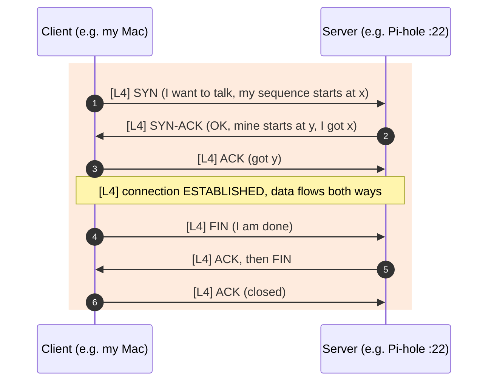
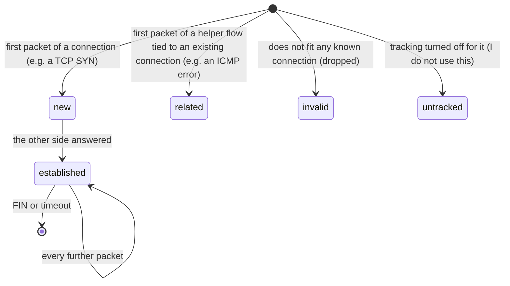
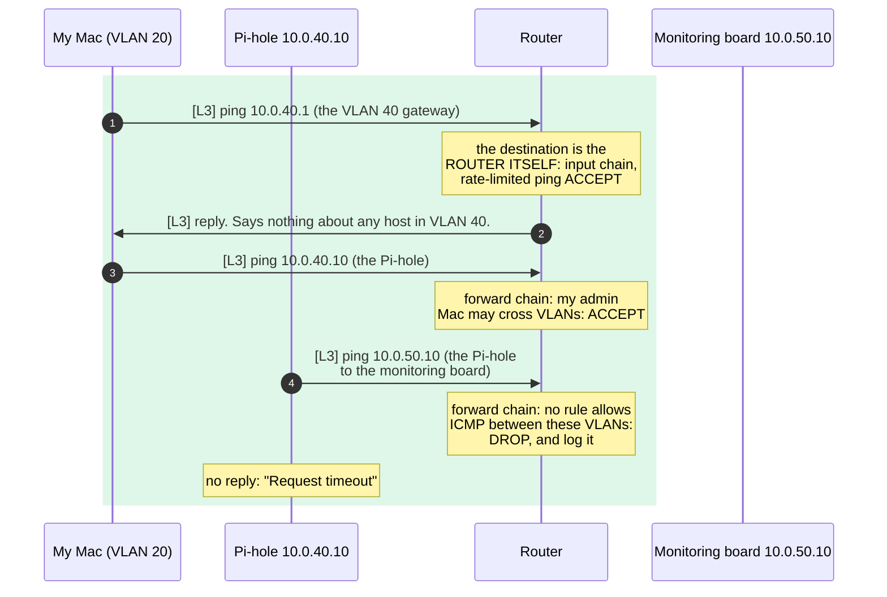

# TCP/IP Protocols

At the transport layer, most homelab traffic reduces to a simple tradeoff: reliability or speed. TCP and UDP make different choices, and your applications inherit those choices.

## Ports: Which Program

A **port** is a number from 0 to 65535 that picks which program on a computer gets the data. Servers listen on well-known ports; the client side picks a random high one. You will see it written `10.0.40.10:22` or `tcp/22`.

If the IP address is the street address, the port is the person inside the flat. Same address, different recipients.

Not to be confused with a **switch port**, which is a socket you plug a cable into (`ether2`).

The ports I meet every day:

| Port | What | Transport |
|---|---|---|
| 22 | SSH | TCP |
| 53 | DNS | UDP, and TCP for big answers |
| 67 / 68 | DHCP (server / client) | UDP |
| 123 | NTP | UDP |
| 443 | HTTPS | TCP |
| 8006 | Proxmox web UI | TCP |
| 8291 | WinBox, MikroTik's admin tool | TCP |
| 3128 | Squid proxy | TCP |
| 3142 | apt-cacher-ng | TCP |

Most firewall rules say "this source may reach that port".

## TCP

TCP guarantees that data arrives in order and that lost packets are retransmitted. It establishes a connection first, then starts sending data.[^1]

Think of a phone call. You dial, they pick up, you both say hello, and you notice when the line drops. TCP opens with a three-step handshake, numbers every byte so nothing is lost, and closes politely:

Used by HTTP, HTTPS, SSH, and databases - anything where missing or reordered data is unacceptable. In my lab: SSH, HTTPS, WinBox and the Proxmox UI.

## UDP

UDP skips the handshake and sends packets immediately.[^2] That makes it faster and simpler, but packets can be lost or arrive out of order. If an answer does not come, the program itself asks again.

Think of a postcard. You post it and hope; there is no receipt.

Used by DNS queries, DHCP, NTP, video streaming, VoIP, and gaming - situations where speed matters more than perfect delivery. WireGuard, the tunnel under Tailscale, runs over UDP too.

## TCP vs UDP

| | TCP | UDP |
|-----|-----|-----|
| Guaranteed delivery | Yes | No |
| Ordered arrival | Yes | No |
| Speed | Slower (handshake overhead) | Faster |
| Feels like | A phone call | A postcard |
| Use cases | HTTP, SSH, FTP | DNS, video, gaming |
| In my lab | SSH, HTTPS, WinBox, Proxmox UI | DNS, DHCP, NTP, WireGuard |

## Connection Tracking: The Router's Memory

My router's firewall is **stateful**. It remembers every connection it lets through, in the *connection tracking* table, and gives each packet a state:[^3]

Think of the guard's visitor log. Replies are let in because they match an entry in today's log.

This is why the firewall only needs rules for the **first packet** of a connection. My router's first rules FastTrack `established` and `related` connections, accept `established`, `related` and `untracked` packets, and drop `invalid` ones. The answer to an allowed request is always allowed back; an unsolicited packet from outside never is.

UDP has no connection of its own, but the router tracks it all the same: a DNS answer counts as part of the same conversation as the question.

Connection tracking is also what makes NAT possible. Each reply is looked up in the table so the router can undo its address swap. [Router Essentials](/pages/networking/basics/router-essentials) shows both.

**FastTrack.** For established connections my MikroTik also uses FastTrack, a fast path that skips most of the router's packet processing, the firewall rules included.[^4] After the first packets, the rest of a download runs at full speed without loading the CPU much.

## Drop Or Reject

My lab **drops** (silently discards) and logs. The sender gets no answer, so the symptom is a **timeout**: it waits, then gives up. It never sees "connection refused".

"Connection refused" means the packet *reached* the host and nothing was listening on that port.

So the two messages point at different layers. A timeout says look at the firewall, or at whether the host is up. "Refused" says the network is fine and the service is not running.

## Ping Proves Less Than You Think

ICMP carries the network's control messages: "are you there?" and "yes" (echo request and reply, which is what `ping` sends), "cannot reach that address", and "too many hops", which `traceroute` uses.[^5] ICMP has no ports.

A reply proves the target is up and that the path lets ICMP through. It does not prove that the service you want is reachable. Knocking on a door: an answer means someone is home, not that the shop inside is open.

- The router owns every `.1` address, so a gateway ping only proves the router is alive.
- To test whether a flow is allowed, test **that flow**: the TCP port, from the source VLAN. `nc -vz 10.0.10.20 8006` asks whether the Proxmox UI answers. Then read the router's drop log.

If you are debugging a system, this matters because TCP failures usually look like connection resets, retries, or timeouts, while UDP failures often look like intermittent packet loss or missing responses.

## Related Topics

- [Network Words In A Nutshell](/pages/networking/basics/network-words) - port, TCP, UDP, conntrack and ping in one page.
- [OSI Model](/pages/networking/basics/osi-model) - where L4 sits, and how a symptom points at a layer.
- [Router Essentials](/pages/networking/basics/router-essentials) - the firewall chains and NAT that build on connection tracking.
- [IP Addressing and Subnetting](/pages/networking/basics/ip-addressing-subnetting) - private ranges and subnets, which used to sit on this page.

[^1]: [RFC 9293, Transmission Control Protocol (TCP)](https://www.rfc-editor.org/rfc/rfc9293), section 3.5: the three-way handshake.
[^2]: [RFC 768, User Datagram Protocol](https://www.rfc-editor.org/rfc/rfc768): delivery and duplicate protection are not guaranteed.
[^3]: [MikroTik, Connection tracking](https://manual.mikrotik.com/docs/firewall-and-quality-of-service/connection-tracking/), "Connection states": `new`, `established`, `related`, `invalid` and `untracked`.
[^4]: [MikroTik, Connection tracking](https://manual.mikrotik.com/docs/firewall-and-quality-of-service/connection-tracking/), "FastTrack": a fast path that bypasses most of the packet processing of the router, for TCP and UDP connections a rule has selected; IPv4 only.
[^5]: [RFC 792, Internet Control Message Protocol](https://www.rfc-editor.org/rfc/rfc792): echo and echo reply, destination unreachable, and time exceeded.
