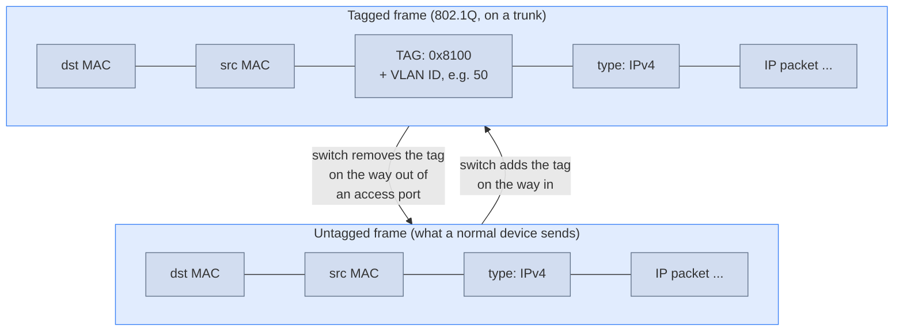
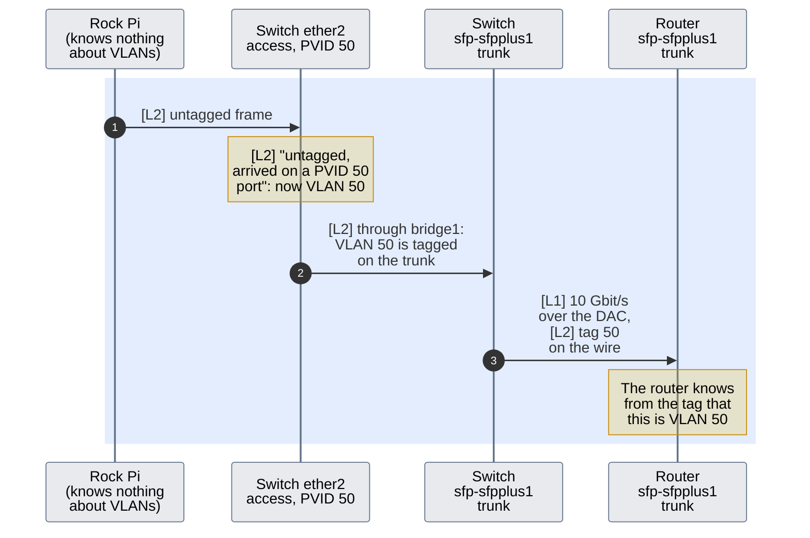
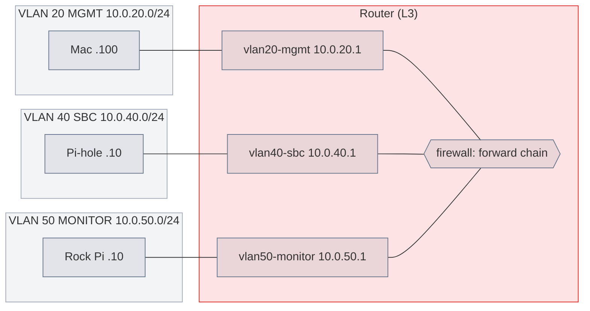
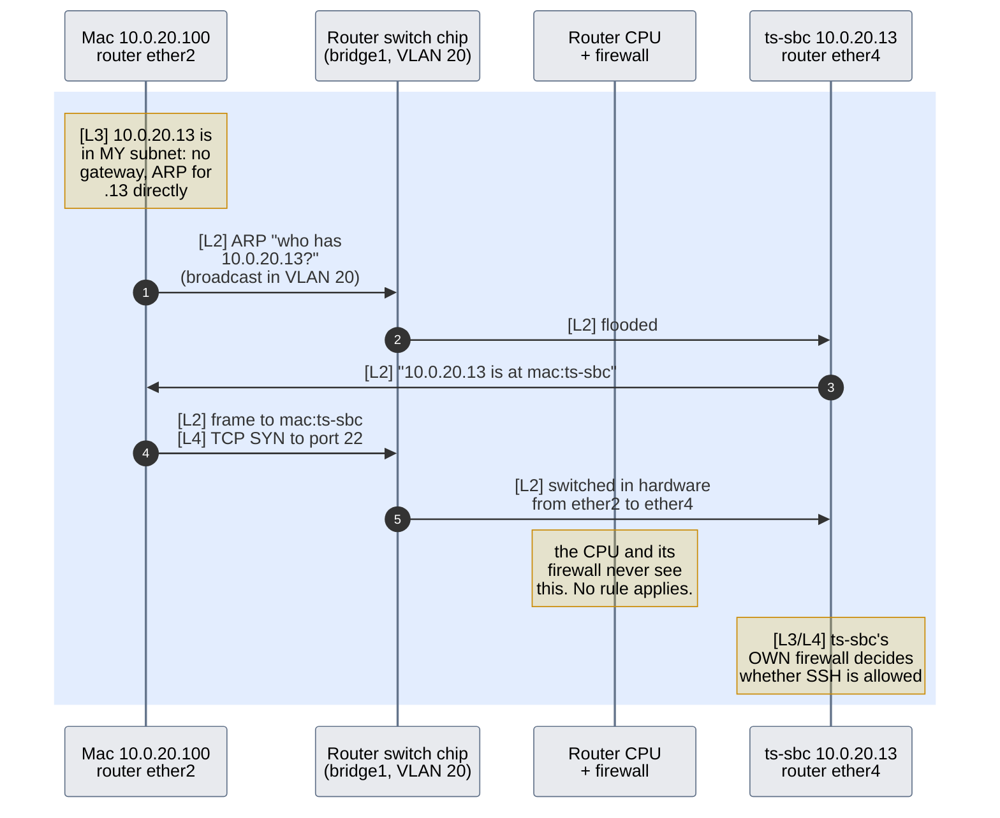
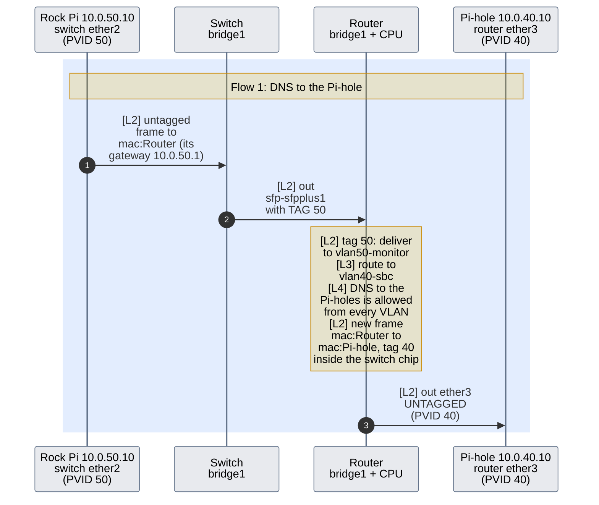
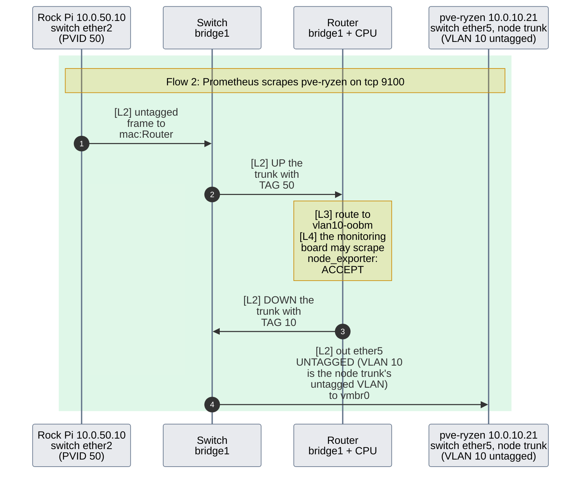
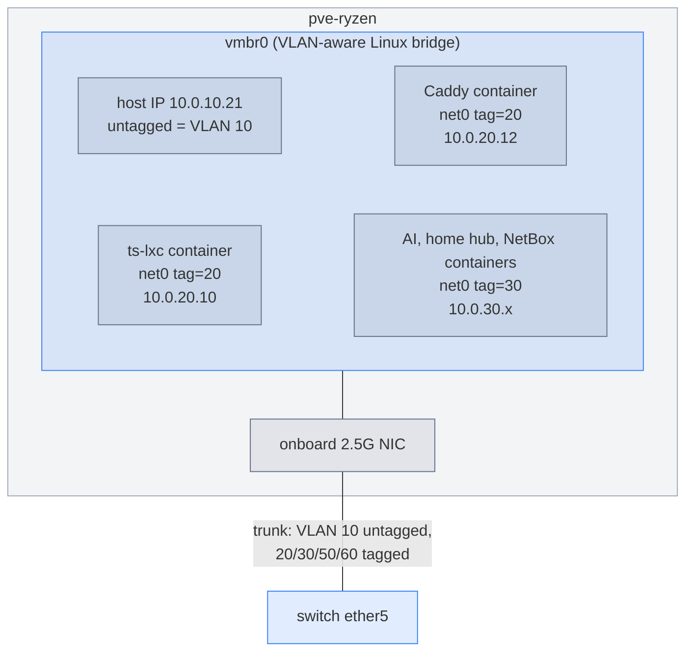

# VLANs & Broadcast Domains

At a physical level, a network switch connects devices together. Once a homelab has management interfaces, guest networks and services you might expose, putting every device on one switch with no separation becomes a security and performance problem.

Without VLANs you need one switch and one cable per network. A **VLAN** (Virtual LAN) lets one switch and one cable carry many separate networks.

## Broadcast Domains

A **broadcast** is one message for every device in the local network at once. Devices use it when they do not yet know whom to ask:

- *"Who has the IP `192.168.1.1`? Tell `192.168.1.50`!"* (ARP Requests)
- *"Is there a DHCP server out here? I need an IP!"* (DHCP Discover)

A **broadcast domain** is the set of devices that hear each other's broadcasts. Think of an announcement over a building's loudspeaker: every flat in this building hears it, the next building does not.

In a flat network, **every single device** connected to the switch must receive, process and discard these broadcast packets. The more devices, the more of this background noise each one handles.

A broadcast never crosses a router. Shrinking the broadcast domain restricts the noise, and it also restricts who can talk to whom without a router in between.

## VLANs: Separate Buildings On Shared Roads

A VLAN splits a single physical switch into multiple isolated virtual switches.

Think of separate buildings that share the same roads and pipes. Devices in VLAN 10 and VLAN 20 may plug into the same switch, but they cannot hear each other's broadcasts. More importantly, they cannot talk to each other at all unless the traffic passes through a router, and therefore through its firewall.

### The Tag

VLANs are not magic. Each frame on a shared link carries a **tag** with its **VLAN ID**, a number from 1 to 4094. The tag format is the IEEE 802.1Q standard,[^1] and a VLAN-aware switch recognises a regular 802.1Q tag by its type, `0x8100`.[^2]

## Access Ports And Trunk Ports

Because frames can carry a tag, each switch port needs to know whether to expect one.

*   **Access Port:** The port is assigned to a single VLAN (e.g., VLAN 40). The device connected to it (like a PC, TV, or unmanaged switch) has no idea VLANs exist. It sends standard, untagged traffic. As the traffic enters the switch, the switch **adds** the VLAN 40 tag. As traffic leaves the port toward the PC, the switch **strips** the tag.
*   **Trunk Port:** The port carries multiple VLANs. The traffic remains "tagged" as it leaves the switch. The device receiving the traffic (like a Proxmox host or another managed switch) must be "VLAN-aware" so it can read the 802.1Q tag and sort the traffic accordingly.

| Port type | Carries | Frames on the wire | Typical device | In my lab |
|---|---|---|---|---|
| **Access** | exactly one VLAN | **untagged** | a normal computer, a Pi | Switch `ether2` (the monitoring board, VLAN 50) |
| **Trunk** | many VLANs | **tagged** (maybe one VLAN untagged) | another switch, a hypervisor, a Wi-Fi access point | Router `sfp-sfpplus1` (all VLANs), switch `ether5` (a Proxmox node) |

### The Words MikroTik Uses

My router and switch are MikroTiks. RouterOS uses three settings for all of this:[^3]

- **PVID** (port VLAN ID): the VLAN an *untagged* frame belongs to when it enters this port. The router's `ether2` has PVID 20, so my Mac's untagged frames are VLAN 20 inside the switch.
- **frame-types**: what the port accepts. `admit-only-untagged-and-priority-tagged` on access ports, so a device cannot pretend to be in another VLAN by tagging its own frames. `admit-only-vlan-tagged` on the 10G trunk between router and switch. `admit-all` on the mixed ports: the Proxmox node trunks and the link to the Wi-Fi access point, which carry one VLAN untagged and others tagged.
- **vlan-filtering=yes** on the bridge: the switch actually enforces all of the above. Without it, the VLAN settings are ignored and everything is one big network.

Here is a frame from my monitoring board (a Rock Pi) reaching the router:

### Native VLAN And VLAN Hopping

What happens if an untagged packet arrives on a Trunk Port?

This is handled by the **Native VLAN** (or PVID - Port VLAN ID). The switch assigns any untagged traffic arriving on a trunk port to the Native VLAN.

The classic attack, VLAN hopping, is a device tagging its own frames to land in a VLAN it does not belong to. In my lab the frame-types do the work. An access port only admits untagged frames, so a tagged frame from a device is dropped at the door. The trunk between router and switch only admits tagged frames, so it has no native VLAN at all.

## Routing Between VLANs

VLANs are separate on purpose. To go from VLAN 20 to VLAN 40 a packet must be **routed**, and in my lab the only router is the RB5009. It has one virtual interface per VLAN (`vlan20-mgmt`, `vlan40-sbc`, ...), each holding that VLAN's gateway address. So the router is the one place where every VLAN meets, and therefore the one place to put the firewall.

## Inside One VLAN, The Router Never Looks

This is the most important thing to understand about VLANs and security. Two hosts in the same VLAN talk straight through the switch, and the router's firewall never sees it:

`ts-sbc` is a Raspberry Pi that runs one of my two Tailscale routers. It sits in VLAN 20, next to my Mac.

<Callout type="warning">

**A VLAN is one room.** Anything in it can reach anything else in it, whatever the router's rules say. Only each host's own firewall can stop it. That is why I keep my management VLAN small, and why I do not trust it as a whole.

</Callout>

The same holds across the trunk. My Mac reaching Caddy (`10.0.20.12`, a container on a Proxmox node) goes Mac → router switch chip → trunk tagged 20 → switch → node trunk tagged 20 → the node's `vmbr0` → the container. All L2, no router firewall.

## Across The Trunk, Twice

The monitoring board in VLAN 50 is plugged into the switch. Two of its flows show what the trunk does:

1. **A DNS question to the Pi-hole** (VLAN 40, plugged into the **router**): it crosses the trunk once.
2. **A metrics scrape of a Proxmox node** (VLAN 10, plugged into the **switch**): it crosses the trunk **twice**, because only the router can move a packet from VLAN 50 to VLAN 10.

What the envelopes look like for flow 2:

| Segment | VLAN tag on the wire | L2 source → destination | L3 source → destination | TTL |
|---|---|---|---|---|
| Rock Pi → switch `ether2` | none | `mac:RockPi` → `mac:Router` | `10.0.50.10` → `10.0.10.21` | 64 |
| Switch → router (trunk, up) | **50** | `mac:RockPi` → `mac:Router` | same | 64 |
| *Router routes: VLAN 50 → 10* | — | **rewritten** | same | **63** |
| Router → switch (trunk, down) | **10** | `mac:Router` → `mac:pve-ryzen` | same | 63 |
| Switch `ether5` → pve-ryzen `vmbr0` | none | `mac:Router` → `mac:pve-ryzen` | same | 63 |

What to notice:

- **The switch never changes the MACs or the IPs.** It only adds or removes the tag at the edge.
- **Traffic between two VLANs on the switch always makes this round trip.** That is the price of having one router, and one firewall, for everything. The 10G trunk makes it cheap; [Network Topologies](/pages/networking/basics/network-topologies) has the measured numbers.
- **The switch drops a tagged frame on an access port**, so a device cannot jump VLANs by tagging its own frames.

## Proxmox: One Trunk Per Node

In a homelab, your Proxmox host connects to the switch via a Trunk Port.

Inside Proxmox, the default virtual bridge (`vmbr0`) acts as a virtual managed switch. When you check the "VLAN aware" box in Proxmox's network settings, `vmbr0` learns how to read 802.1Q tags.[^4]

When you create a VM and type "10" into the VLAN Tag box, Proxmox creates a virtual Access Port for that specific VM. The VM thinks it is on a normal flat network, but Proxmox tags all its traffic as VLAN 10 before sending it down the physical Trunk Port to your core switch.

My nodes use one pattern, the **node trunk**. The host's own address lives on `vmbr0` **untagged**, in VLAN 10. Each guest's network card is attached to `vmbr0` **with a tag** for its own VLAN:

The switch port must match: VLAN 10 untagged for the host, the guest VLANs tagged.

Two mistakes this pattern makes easy:

- **A guest that belongs in VLAN 10 must be untagged on `vmbr0`, never `tag=10`.** VLAN 10 is the untagged VLAN on the node trunk, so the switch sends its frames untagged.
- **A node trunk must be a trunk.** Until 29 October 2026 my first node's `vmbr0` sat behind an unmanaged switch on an **access** port in VLAN 10. That port dropped every tagged frame, so the host worked and every guest in another VLAN had no network at all.

[Linux Bridges in Proxmox](/pages/networking/homelab-network/linux-bridges-proxmox) explains the bridge itself.

## My Ten VLANs

| VLAN | Name | Subnet | Who lives here | Internet |
|---|---|---|---|---|
| 10 | OOBM | `10.0.10.0/24` | Proxmox hosts, both BMCs, the KVM, the TrueNAS UI | Only through the proxy |
| 20 | MGMT | `10.0.20.0/24` | My admin Mac, the Tailscale routers, Caddy, the switch | Yes |
| 30 | COMPUTE | `10.0.30.0/24` | Containers and VMs (AI, apps) | Yes |
| 40 | SBC | `10.0.40.0/24` | The two Pi-holes, the proxy | Time only. The exceptions are the proxy itself (web) and the Pi-holes and the proxy (DNS) |
| 50 | MONITOR | `10.0.50.0/24` | The monitoring board | Only through the proxy |
| 60 | STORAGE | `10.0.60.0/24` | Storage network cards (NFS) | Only through the proxy |
| 70 | CLIENT | `10.0.70.0/24` | Phones and laptops on the main Wi-Fi | Yes |
| 75 | GUEST | `10.0.75.0/24` | Visitors on the guest Wi-Fi | Public addresses only |
| 80 | IOT | `10.0.80.0/24` | Smart devices on the IoT Wi-Fi | Time, web, MQTT over TLS and ping, to public addresses only |
| 90 | DMZ | `10.0.90.0/24` | Reserved for future public services (empty) | No |

Why so many VLANs? **Blast radius.** If a smart plug (IoT) or a phone or laptop on Wi-Fi (CLIENT) is compromised, it is in a VLAN that can reach almost nothing. The BMCs and hypervisors (OOBM), whose compromise would be the worst, sit in a VLAN that cannot reach the internet at all.

The [Homelab Drawing Set](/pages/homelab-architecture/drawing-set) draws every VLAN and every address on its logical sheet.

## Related Topics

- [Network Words In A Nutshell](/pages/networking/basics/network-words) - VLAN, broadcast, trunk, access port and PVID in one page.
- [IP Addressing and Subnetting](/pages/networking/basics/ip-addressing-subnetting) - one subnet per VLAN, and how a host decides who is local.
- [Router Essentials](/pages/networking/basics/router-essentials) - the firewall every cross-VLAN packet passes.
- [Network Topologies](/pages/networking/basics/network-topologies) - what the trunk round trip costs in practice.
- [Linux Bridges in Proxmox](/pages/networking/homelab-network/linux-bridges-proxmox) - the bridge inside each Proxmox node.
- [The Old Router Became An Access Point](/pages/homelab-architecture/decisions/wifi-access-point) - three Wi-Fi names on three VLANs.

[^1]: [IEEE 802.1Q, Bridges and Bridged Networks](https://standards.ieee.org/ieee/802.1Q/10323/).
[^2]: [MikroTik, Bridge VLAN Table](https://manual.mikrotik.com/docs/bridging-and-switching/user-guides/bridge-vlan-table/): "0x8100 - IEEE 802.1Q, Customer VLAN (regular VLAN tag)".
[^3]: [MikroTik, Bridging and Switching](https://manual.mikrotik.com/docs/bridging-and-switching/): `pvid` (1 to 4094) assigns untagged ingress traffic to a VLAN, `frame-types` is one of `admit-all`, `admit-only-untagged-and-priority-tagged` or `admit-only-vlan-tagged`, and both only take effect when `vlan-filtering` is `yes`.
[^4]: [Proxmox VE, Network Configuration](https://pve.proxmox.com/wiki/Network_Configuration), "VLAN 802.1Q": VLAN awareness on the Linux bridge, and a VLAN tag set per guest network card.
