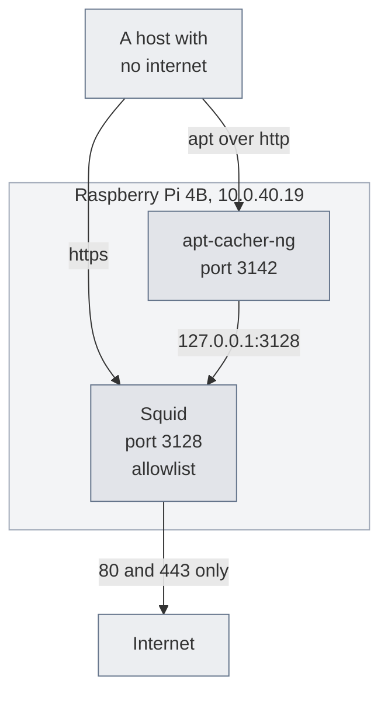

# Package Cache On A Raspberry Pi

The package cache used to be a container. CT 800, one core, one job.

It still has one job. It just moved out of the hypervisor.

The short reason: the lab got a proxy that every isolated network has to use anyway, and that proxy caches packages too. [Three Guests I Removed](/pages/homelab-architecture/decisions/removed-guests) has the rest.

<LabSheet sheet="physical" focus="infra-proxy" caption="The proxy board, plugged straight into the router." />

## One Door Out

The board is a spare Raspberry Pi 4B. It sits in the SBC network, VLAN 40, at `10.0.40.19`, and it runs two things:

- **Squid, on port 3128.** The only way out. It allows a short list of domains, by name, on ports 80 and 443. Everything else is denied.
- **apt-cacher-ng, on port 3142.** The package cache. It fetches through the local Squid, never directly, so one allowlist governs both.

One door, one list.



The hosts that use it: the Proxmox nodes and the rest of VLAN 10 (OOBM), the compute VLAN, the other small boards, and the monitoring board. The storage VLAN gets Squid only.

A few details that matter more than they look:

- **By name, not by address.** The allowlist uses Squid's `dstdomain` with the `-n` option. Without `-n`, a request for a bare IP address makes Squid look up that address's name and try the list again. With `-n` there is no lookup, and the request is simply denied.[^squid] A domain on the list cannot be reached by typing its IP address instead.
- **Squid does its own DNS.** It resolves names with public resolvers, not with my Pi-holes. The Pi-holes install their own updates through this proxy, so leaning on them would be a loop.
- **A bad config never goes live.** The role checks the Squid config with `squid -k parse` before it replaces the live file.
- **The proxy patches itself.** It runs `unattended-upgrades` and fetches its own updates directly.
- **The router agrees.** In the SBC VLAN, only this board may reach the internet on ports 80 and 443. The other boards have no web access of their own.

Adding a domain is a reviewed change, not a quick edit. The allowlist is the only thing between a host and the internet.

## Pointing A Host At It

Ansible writes one file, `/etc/apt/apt.conf.d/00proxy`, on every Debian machine in the lab, the Proxmox nodes included:

```text
Acquire::http::Proxy "http://10.0.40.19:3142";
Acquire::https::Proxy "http://10.0.40.19:3128";
Acquire::http::Pipeline-Depth "0";
```

Two lines, two paths:[^apt-proxy]

- **http** goes to apt-cacher-ng, and gets cached. The first host to ask for a package pays for the download. The rest get the local copy.
- **https** goes to Squid, and is passed straight through. An https download is encrypted end to end, so a cache in the middle has nothing it can keep. apt-cacher-ng's own manual says the same about tunnelled TLS.[^acng-https]

The proxy itself gets no file. Neither do the hosts in VLAN 20 (MGMT), which reach the internet directly: the two Tailscale routers and the reverse proxy.

Proxmox's own downloads, the container templates among them, do not read apt's file. They go through the datacenter `http_proxy` option, which points at Squid. [How I Build A Node Now](/pages/proxmox/setup/building-a-node) covers that side.

## The Line That Made It Reliable

The third line of that file is there because of the monitoring board.

On 28 October 2026 the Rock 5B would not update. apt stopped with `File has unexpected size`. apt-cacher-ng had answered one request with the body of the file before it.

apt sends several requests down one connection without waiting for each answer. That is HTTP pipelining. Behind a mirror that redirects, apt-cacher-ng got the answers out of order.

The fix is one setting, now on every host:

```text
Acquire::http::Pipeline-Depth "0";
```

Zero turns pipelining off.[^pipeline] One request at a time.

### Mirrors That Redirect

The same day taught me a second thing. Armbian's package address does not serve packages itself. It redirects each request to a mirror, and not always the same mirror.

An allowlist cannot keep up with that. Whichever mirror I allowed, the next request could be sent somewhere else.

So the board now points at one mirror directly, and only that mirror is on the list.

## What It Costs Me

- If the board is down, the isolated networks wait for their updates.
- Every new download source means an allowlist change, and I read the plan before I apply it.

Same job as the container. One less guest on the hypervisor, and one door out instead of many.

## Related Topics

- [Apt-Cacher-NG LXC On Proxmox](/pages/services/apt-cacher-ng-lxc) - the container version, as I first built it.
- [Three Guests I Removed](/pages/homelab-architecture/decisions/removed-guests) - why the container went.
- [How I Build A Node Now](/pages/proxmox/setup/building-a-node) - a Proxmox node with no internet of its own.
- [Monthly Updates With Ansible](/pages/proxmox/operations/monthly-updates) - the update run that goes through this board.
- [Monitoring On Its Own Board](/pages/proxmox/monitoring-and-alerts/monitoring-on-its-own-board) - the alerts leave through the same Squid.
- [Pi-hole In A Homelab](/pages/networking/pihole) - the other small boards in the SBC network.

[^squid]: [Squid configuration directive `acl`](http://www.squid-cache.org/Doc/config/acl/): for `dstdomain`, "a reverse lookup is tried if a IP based URL is used and no match is found"; with `-n`, the ACL "would immediately declare a mismatch without any warnings or lookups".
[^apt-proxy]: [`apt-transport-http(1)`, "Proxy Configuration"](https://manpages.debian.org/trixie/apt/apt-transport-http.1.en.html#Proxy_Configuration): proxies for APT are set with `Acquire::http::Proxy`. [`apt-transport-https(1)`](https://manpages.debian.org/trixie/apt/apt-transport-https.1.en.html): the http options are also available under `Acquire::https`.
[^acng-https]: [Apt-Cacher NG manual, "Access to SSL/TLS remotes (HTTPS)"](https://www.unix-ag.uni-kl.de/~bloch/acng/html/howtos.html#ssluse): with tunnelling, "the proxy has no control of the data flowing through it so the proxy cannot cache the data in any useful way".
[^pipeline]: [`apt-transport-http(1)`, "Connection Configuration"](https://manpages.debian.org/trixie/apt/apt-transport-http.1.en.html#Connection_Configuration): `Acquire::http::Pipeline-Depth` enables HTTP pipelining, with a default of 10, and setting it to 0 disables it.
